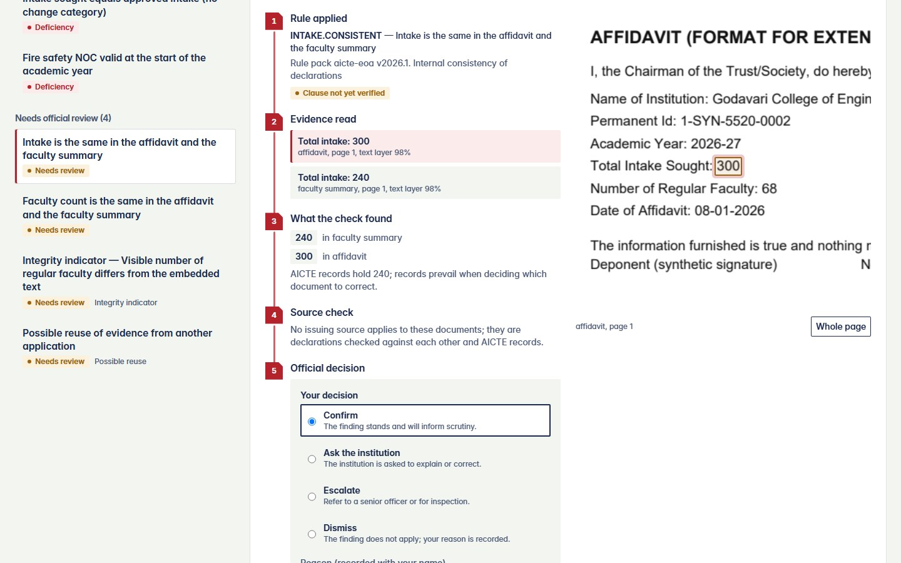
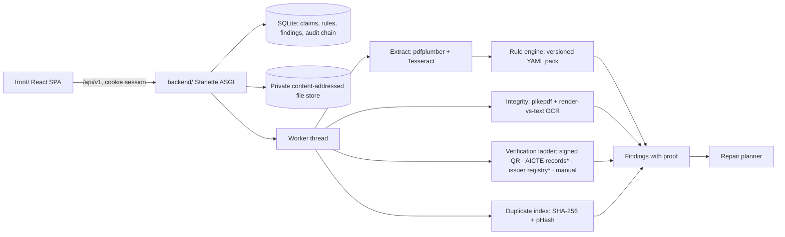

<<<<<<< HEAD
# PRAMAAN — evidence-linked validation for AICTE approval applications

**Smart India Hackathon 2026 · Problem statement SIH26261** — *AI-Powered Application Validation, Document Authentication and Regulatory Compliance Verification*
Organization: AICTE (Regulation Bureau) · Category: Software · Theme: Smart Automation
> The PS ID and wording come from the team's problem-statement document; public archives of SIH 2026 statements do not yet include SIH26261, so confirm them on [sih.gov.in](https://sih.gov.in/sih2026PS) before submission.

PRAMAAN (प्रमाण, "proof") checks an approval application before scrutiny begins. Every finding it raises carries a replayable proof: **the Handbook rule → the value read from a specific place on a specific page → what the issuing source said → the officer's recorded decision.** It never approves, rejects or calls a document forged. Officials decide.



**Everything in one file:** [docs/PRAMAAN_COMPLETE_PROJECT.md](docs/PRAMAAN_COMPLETE_PROJECT.md) covers the problem, research, slides, design, build, results, demo and next steps.

---

## What is implemented (and what is not)

| Area | Status in this repository |
|---|---|
| Sign-in, roles (institution, officer, administrator, auditor), object-level access control | **Working** — server-enforced, tested |
| Application workspace: category checklist, uploads with real progress, async processing stages | **Working** |
| Extraction with provenance: text layer + Tesseract OCR for scans, every value stored with page, bounding box, method, confidence | **Working** |
| Versioned rule pack (17 rules, YAML) with safe expression evaluator and proof traces; outcomes PASS / FAIL / NOT_EVALUABLE | **Working** |
| Cross-document and AICTE-record reconciliation, reprint-aware dates, category scoping | **Working** |
| Verification ladder with the six PS statuses | **Working** — signed-QR check is real Ed25519 cryptography (against synthetic issuer keys); AICTE records and issuer registry are **simulated** stand-ins, labelled in the API and UI |
| Integrity indicators: incremental PDF revisions, metadata date order, text-layer vs rendered-pixel mismatch (overlay edits) | **Working**, worded as indicators, abstains when OCR is unsure |
| Duplicate-evidence index (SHA-256 + perceptual hash) with same-trust allow-list | **Working** on the synthetic corpus |
| Compliance Repair Planner and targeted re-validation (only rules that read the changed document re-run) | **Working** |
| Officer decisions with mandatory reason; hash-chained audit log with verifier | **Working** |
| Rule governance: parameter proposals create a new version; a *different* administrator must activate it | **Working** |
| Synthetic fault-injection benchmark with hard negatives | **Working** — results below |
| DigiLocker / API Setu, real issuer APIs, AICTE portal and SSO integration | **Not built** — needs AICTE authorization; adapter slots exist |
| PostgreSQL, Redis queue, S3 storage, Next.js, FastAPI | **Not used in this build** (package registries were unreachable from the build workspace); swap paths are documented in [ARCHITECTURE §9](docs/ARCHITECTURE.md#9-swap-paths-when-registries-are-available) |
| Deep-learning forensics, conformal calibration, floor-plan / equipment CV | **Not built** (no licensed data; see requirements matrix) |
| Rule clause references | **Placeholders** marked `TO_VERIFY` until checked against the Approval Process Handbook text (16 of 17; the one exception cites an instruction seen on a public 2026-27 EoA letter) |

## Measured results (synthetic data only)

From `python -m eval.benchmark` (34 bundles: 13 planted-fault types × 2, and 4 valid look-alike types × 2), run on 21 Oct 2026, CPU only:

| Measure | Result |
|---|---|
| Planted faults detected | **26 of 26** |
| Valid look-alikes (reprinted letter, scanned affidavit, legitimate re-save, clean) that still got a finding | **2 of 8** — both "legitimate re-save" bundles raised the *modified after creation* indicator, as designed |
| Findings not explained by a planted fault | 2 of 34 |
| Median processing time per bundle (5–6 documents) | 2.7 s |

The generator and the extractors were built together, so these numbers are optimistic. They show the pipeline behaves as specified; they are **not** evidence of accuracy on real AICTE submissions, regional-language documents or handwriting.

---

## Problem and approach

AICTE scrutiny officers check Extension-of-Approval files by hand: are affidavits, NOCs, certificates, faculty and intake data present, valid, consistent with each other and with AICTE's own records, and genuine? Problems surface late and reasons are hard to trace. PRAMAAN gives each application an early, explainable pre-check.

**Three differentiators**
1. **Proof-carrying findings.** Rules are data with clause citations, evaluated by a whitelisted-AST evaluator. A finding stores the rule version, every input with its page coordinates and the evaluated values — an officer can check it in seconds.
2. **Honest uncertainty.** A verification ladder tries the strongest channel first and records each attempt. Unreadable values make a rule abstain (`NOT_EVALUABLE`) instead of guessing; an unavailable source is never treated as fraud; integrity checks say "indicator", never "forged".
3. **Closed-loop repair.** The planner groups findings by the document that would clear them (using AICTE records as the tie-breaker when two documents disagree), and uploading a correction re-runs only the rules that read it.

## User roles and workflows

| Role | Can |
|---|---|
| Institution | Create applications, upload documents, see findings and the repair plan for their own applications only, submit |
| Scrutiny officer | See submitted applications, inspect proof chains and evidence, record decisions (confirm, dismiss, escalate, ask the institution) |
| Rule administrator | Everything an officer can, plus propose rule-pack changes and activate another administrator's proposal |
| Auditor | Read-only view of applications, audit trail and chain verification |

## Architecture


\* simulated in this build. Details: [docs/ARCHITECTURE.md](docs/ARCHITECTURE.md).

## Technology

| Layer | Choice | Why |
|---|---|---|
| Web client | React 19, TypeScript, Tailwind CSS v4, Zod, esbuild | Typed, accessible UI; Tailwind compiled at build time; no runtime CDN |
| API | Starlette (ASGI) + Pydantic, with a typed route registry | Same foundation as FastAPI; one model set drives validation, serialization and the generated contract |
| Data | SQLite (WAL) with ordered SQL migrations; content-addressed private file store | Runs anywhere; DDL is portable to PostgreSQL |
| Documents | pdfplumber (words + coordinates), pypdfium2 (rendering), pikepdf (structure), Tesseract (OCR) | Deterministic, explainable, CPU-only |
| Verification | `cryptography` (Ed25519), OpenCV QR detectors | Real signature checks on signed QR payloads |
| Similarity | OpenCV `img_hash` pHash, SHA-256 | Reuse detection without training data |
| Security | scrypt passwords, short-lived HS256 JWT in HttpOnly SameSite=Strict cookie, CSRF header, rate limits, CSP | See [docs/SECURITY.md](docs/SECURITY.md) |

## Repository layout

```text
backend/            ASGI API, pipeline, rule packs, synthetic data, benchmark, tests
  app/              config, db, security, audit, api registry, routes/, pipeline/
  migrations/       ordered SQL migrations
  rulepacks/        versioned YAML rule packs (aicte-eoa/2026.1.yaml)
  synthetic/        synthetic document generator and seed script
  eval/             fault-injection benchmark
  scripts/          contract generator
  tests/            unit and end-to-end API tests
front/              React web client (src/), build and dev scripts, browser walkthrough (e2e/)
contracts/          generated OpenAPI 3.1 + TypeScript types (do not edit)
docs/               slides, requirements, architecture, API, security, deployment, tests, demo
infra/              nginx config for the containerised web client
.github/workflows/  CI
```

## Run it locally

**Prerequisites:** Python 3.12+ (tested on 3.13), Node 22+, Tesseract OCR (`apt install tesseract-ocr`, `brew install tesseract`, or the Windows installer).

```bash
# 1. Backend
cd backend
python -m venv .venv && source .venv/bin/activate      # Windows: .venv\Scripts\activate
pip install -r requirements.txt
python -m synthetic.seed --reset        # creates the database, synthetic institutions, demo accounts, demo files
python -m eval.benchmark                # optional: produces the benchmark report shown in the UI (≈2 min)

# 2. Web client
cd ../front
npm install
npm run build                           # writes front/dist

# 3. One process serves API + web client
cd ../backend
FRONT_DIST=../front/dist uvicorn app.main:app --port 8000
# open http://localhost:8000
```

Demo accounts and the shared password are printed by the seed script and saved to `backend/var/demo_credentials.txt` (git-ignored). Set `SEED_DEMO_PASSWORD` to choose the password. Files for a live upload demo are written to `backend/var/demo_files/`.

**Development with live reload:** run the API on :8000 (step 3 without `FRONT_DIST`), then `cd front && npm run dev` and open http://localhost:5173 — the dev server rebuilds on change and proxies `/api`.

### Database and migrations
Migrations in `backend/migrations/NNNN_*.sql` are applied automatically at startup (and by the seed script) and recorded in `schema_migrations`. Add a new numbered file for any schema change; never edit an applied one.

### Environment variables
See [`.env.example`](.env.example). Production refuses to start with a default or short `JWT_SECRET`, with `COOKIE_SECURE=false`, or with wildcard CORS.

## Commands

| Task | Command (from the folder shown) |
|---|---|
| Unit tests (20) | `backend$ python -m unittest tests.test_units` |
| End-to-end API tests (14, real server + seeded DB) | `backend$ python -m unittest tests.test_api` |
| Regenerate / check the API contract | `backend$ python -m scripts.gen_contract [--check]` |
| Benchmark | `backend$ python -m eval.benchmark` |
| Type-check the web client | `front$ npm run typecheck` (`typecheck:offline` uses bundled minimal React types) |
| Build the web client | `front$ npm run build` |
| Browser walkthrough with screenshots | `front$ python e2e/walkthrough.py http://localhost:8000 <password> ./shots` (needs Playwright + Chromium) |

## API

27 operations under `/api/v1`, documented in [docs/API_CONTRACT.md](docs/API_CONTRACT.md) and machine-readable in [`contracts/openapi.json`](contracts/openapi.json). Health: `GET /api/v1/health`; readiness (database, rule pack, storage, OCR): `GET /api/v1/ready`.

## The OCR / extraction pipeline
1. **Intake** checks content by magic bytes (PDF, PNG, JPEG), size (10 MB) and page count (40), rejects encrypted or malformed PDFs, and stores the file under its SHA-256.
2. **Extraction** reads words with coordinates from the text layer; pages with no text are rendered at 300 dpi and OCR'd. Template patterns per document type capture each value and its exact span, so the bounding box is the value itself.
3. **Classification** is a transparent keyword score; a mismatch with the declared type becomes a review indicator.
4. **Integrity** counts appended PDF revisions, checks metadata date order, and OCRs the rendered region of each numeric or date value to compare with the embedded text.
5. **Verification ladder** runs per document type, then the **rule engine** evaluates the active pack and findings are reconciled with earlier runs.

## Regulatory rules and verification
Rules live in `backend/rulepacks/aicte-eoa/2026.1.yaml`: completeness, condition (`assert`), cross-document (`consistency`, optional AICTE-record tie-break), validity (`expiry` on typed dates) and source-check rules. Each cites a clause and carries its remedy. Every run records the pack version. Expression syntax is restricted to arithmetic, comparisons, boolean logic and a few pure functions — no attribute access, calls or `eval`.

## Security
Server-side RBAC with object-level checks, private storage, CSRF header, rate limits, security headers, upload hardening, no language model or document-driven execution, hash-chained audit. Threat model and residual risks: [docs/SECURITY.md](docs/SECURITY.md).

## Docker and deployment
`docker compose up --build` builds the API image (with Tesseract) and an nginx image that serves the web client and proxies `/api`. **The Docker files were written but not built in the development workspace (no Docker daemon there).** Production guidance, TLS, backups and rollback: [docs/DEPLOYMENT.md](docs/DEPLOYMENT.md).

## CI
`.github/workflows/ci.yml` runs the contract drift check, unit and end-to-end tests, the web client type-check against real `@types/react`, and the production build.

## Demo walkthrough
Seven-minute script with the synthetic scenarios (clean bundle, planted defects, verification ladder, live upload and repair, audit tamper check): [docs/DEMO_GUIDE.md](docs/DEMO_GUIDE.md). Screenshots are in [docs/screenshots/](docs/screenshots/).

## Known limitations
- Synthetic data and simulated sources only; no claim of real-world accuracy.
- Rule clauses and thresholds (for example the 1:20 student–faculty ratio) are placeholders until a domain reviewer verifies them against the APH 2024-25 to 2026-27 text and corrigenda.
- Extraction templates match the synthetic layouts; real document variety needs new templates or a layout model, evaluated on real samples.
- OCR is English only; Indic scripts are not handled.
- PDF digital signatures are not yet chain-validated (pyHanko + CCA roots planned).
- SQLite and an in-process worker suit a single server; use PostgreSQL and a queue for multiple replicas.
- The browser type-check here used bundled minimal React types; CI checks against the real ones.

## Planned improvements
pyHanko signature validation with CCA trust roots · DigiLocker requester adapter after onboarding · PostgreSQL + Redis worker · layout-model extraction evaluated on authorized samples · rule-pack diff view · alerts · Indic OCR.

## Research and attribution

# PRAMAAN

