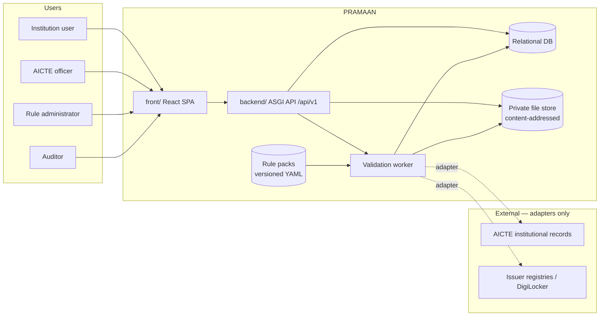
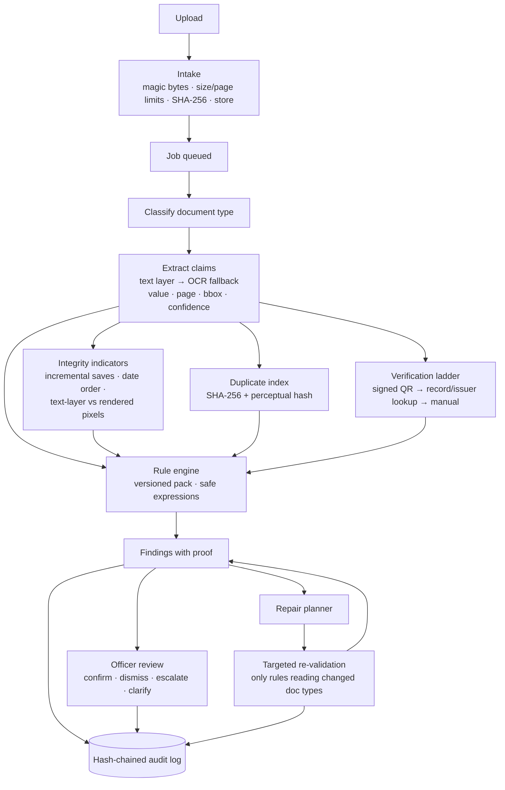

# PRAMAAN — Architecture

## 1. Goals and non-goals

**Goals:** evidence-linked preliminary validation of AICTE approval applications; every finding reproducible from a versioned rule and specific extracted evidence; honest uncertainty; human control; tamper-evident history.

**Non-goals (enforced in code):** approving or rejecting applications, declaring documents forged, calling external systems that are not configured and authorized, using a language model in the decision path.

## 2. Constraints that shaped this build

| Constraint | Effect |
|---|---|
| Package registries (PyPI, npm) unreachable from the build workspace | Stack limited to libraries already installed: Starlette + Pydantic instead of FastAPI; SQLite instead of PostgreSQL driver; React + esbuild instead of Next.js; stdlib `unittest` instead of pytest. All choices are swappable (see §9). |
| No authorized access to AICTE, DigiLocker or issuer systems | Adapters are pluggable; prototype adapters are deterministic and every result they produce is stored with `simulated = true` and shown as **Simulated source** in the UI. |
| No real application data | Synthetic generator produces bundles with planted defects and valid hard negatives, each stamped "SYNTHETIC". |

## 3. System context

## 4. Validation pipeline

### Key decisions
- **Deterministic core.** Extraction is template + regex over positioned words; rules are data evaluated by a whitelisted-AST evaluator (no `eval`). Identical inputs give identical findings.
- **Provenance everywhere.** A claim stores document, page, bounding box (PDF points), extractor and confidence. Findings reference claims, never free text.
- **Abstain, don't guess.** Missing or low-confidence inputs make a rule `NOT_EVALUABLE`, which becomes a review item, never a failure. Integrity checks that can't read the rendered value report nothing rather than a guess.
- **Typed dates.** Extractors distinguish `issue_date`, `print_date`, `valid_from`, `valid_to`; rules reference the type they need, so reprinted letters do not trigger date findings.
- **Two vocabularies.** Rule outcome: `PASS | FAIL | NOT_EVALUABLE`. Document verification: the six PS statuses.
- **Derived application status** (never approve/reject): `DRAFT`, `PROCESSING`, `READY_FOR_SCRUTINY`, `DEFICIENCIES_FLAGGED`, `MANUAL_REVIEW_REQUIRED`.

## 5. Verification ladder

| Tier | Channel | Prototype behaviour | Statuses |
|---|---|---|---|
| 1 | Cryptographic: signed QR (Ed25519) on certificate | **Real verification** against registered issuer public keys (synthetic issuers) | VERIFIED · MISMATCH_DETECTED · EXPIRED |
| 2 | Official record lookup (AICTE records for EoA letters) | Simulated records table | VERIFIED · MISMATCH_DETECTED |
| 3 | Issuer registry by reference number | Simulated; availability configurable per issuer | VERIFIED · MISMATCH_DETECTED · SOURCE_UNAVAILABLE |
| 4 | Manual | Officer records outcome | MANUAL_REVIEW_REQUIRED → officer decision |

`VERIFICATION_PENDING` is shown while a job runs. A source being unavailable never produces a deficiency; it produces a manual-verification action.

## 6. Data model (summary)

`institutions`, `users`, `aicte_records` (simulated), `applications`, `documents`, `claims`, `verifications`, `integrity_signals`, `validation_runs`, `rule_results`, `findings`, `reviews`, `jobs`, `rule_pack_versions`, `issuers`, `issuer_registry` (simulated), `audit_events`, `schema_migrations`. Full DDL: `backend/migrations/`.

Audit chain: `hash = SHA-256(prev_hash ‖ seq ‖ ts ‖ actor ‖ action ‖ object ‖ payload_hash)`. `GET /api/v1/audit/verify` recomputes the chain and returns the first broken sequence.

## 7. Security architecture

- Session: short-lived JWT in an `HttpOnly; SameSite=Strict` cookie (Bearer also accepted for API clients). State-changing requests require the `X-Requested-With: pramaan` header (CSRF defence in depth).
- Authorization: role check per route **and** object-level check (institution users only see their own institution's records; cross-tenant ids return 404).
- Uploads: allow-list by magic bytes (PDF, PNG, JPEG), 10 MB and 40-page limits, PDF opened in a guarded parser, stored under its SHA-256 (no user-controlled paths).
- Page images are served only through an authorized endpoint; files are never exposed statically.
- Rate limits: login and upload.
- Headers: CSP, `X-Content-Type-Options`, `X-Frame-Options`, `Referrer-Policy`, `Permissions-Policy`; HSTS in production.
- Startup refuses a default or short `JWT_SECRET` in production.
- Document text is data only: no execution of extracted content. An optional, off-by-default AI layer (see `docs/SECURITY.md`, "AI layer") may propose field values that count only when grounded on the page, reword rule findings under validation, and recommend routing; it never decides.
See `docs/SECURITY.md` for the threat model.

## 8. Frontend architecture

React 19 SPA (`front/`), TypeScript, Tailwind v4 compiled at build time, Zod for runtime validation of API responses, typed client generated from the backend contract (`contracts/`). Routes: landing, sign-in, institution dashboard & application workspace, officer queue & case review, rules, audit, benchmark. Motion uses CSS transitions and the Web Animations API, disabled under `prefers-reduced-motion`.

## 9. Swap paths (when registries are available)

| Prototype | Production swap | Effort |
|---|---|---|
| Starlette + custom typed route decorator | FastAPI (same Pydantic models, same paths) | Low — handlers are thin |
| SQLite + SQL migrations | PostgreSQL (DDL is ANSI-leaning; replace `?` params via driver) | Medium |
| In-process worker thread | Redis + RQ/Celery | Low |
| Local file store | S3-compatible (MinIO) behind the same `Storage` interface | Low |
| React + esbuild | Next.js App Router | Medium |
| Signed-QR + ByteRange checks | + pyHanko chain validation against CCA roots | Medium |
