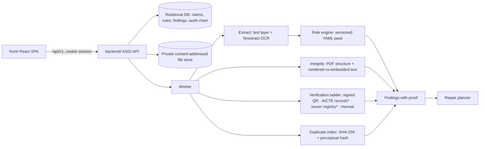

# PRAMAAN: complete project document

**Smart India Hackathon 2026 · Problem statement SIH26261**
*AI-Powered Application Validation, Document Authentication and Regulatory Compliance Verification*
All India Council for Technical Education (AICTE), Regulation Bureau · Category: Software · Theme: Smart Automation

> **PRAMAAN** (प्रमाण, "proof") · *Every flag carries its proof. AI assists, officials decide.*

| | |
|---|---|
| Document date | 22 October 2026 |
| Project state | Working prototype: backend, web client, synthetic data, tests and benchmark all run. External integrations are simulated pending AICTE authorization |
| Team | `<TEAM_NAME>` · Team ID `<TEAM_ID>` · CBIT, Hyderabad |
| Repository | `pramaan/` (this file: `docs/PRAMAAN_COMPLETE_PROJECT.md`) |

This document covers the whole project in one place: the problem, the research, how the idea was chosen, the six presentation slides, the design and architecture, what was built and measured, how to run and demo it, what is still missing, and what to do next. The other files in `docs/` go deeper on single topics; links are given where useful.

---

## Contents

1. [The project at a glance](#1-the-project-at-a-glance)
2. [The problem statement](#2-the-problem-statement)
3. [Research](#3-research)
4. [How the idea was chosen](#4-how-the-idea-was-chosen)
5. [The solution](#5-the-solution)
6. [Users and journeys](#6-users-and-journeys)
7. [Architecture](#7-architecture)
8. [Document intelligence pipeline](#8-document-intelligence-pipeline)
9. [The regulatory rule engine](#9-the-regulatory-rule-engine)
10. [The verification ladder](#10-the-verification-ladder)
11. [Findings, proofs, repair planning and re-validation](#11-findings-proofs-repair-planning-and-re-validation)
12. [Data model](#12-data-model)
13. [API](#13-api)
14. [Web client and design](#14-web-client-and-design)
15. [Security, privacy and AI safety](#15-security-privacy-and-ai-safety)
16. [Testing and measured results](#16-testing-and-measured-results)
17. [Repository structure](#17-repository-structure)
18. [Running, configuring and deploying](#18-running-configuring-and-deploying)
19. [Demo script](#19-demo-script)
20. [The six SIH slides](#20-the-six-sih-slides)
21. [What is real, simulated or missing](#21-what-is-real-simulated-or-missing)
22. [Risks and limitations](#22-risks-and-limitations)
23. [Roadmap, team split and agent workflow](#23-roadmap-team-split-and-agent-workflow)
24. [Pre-submission checklist](#24-pre-submission-checklist)
25. [Questions judges are likely to ask](#25-questions-judges-are-likely-to-ask)
26. [References](#26-references)
27. [Glossary](#27-glossary)

---

## 1. The project at a glance

**The problem.** AICTE officers check approval and Extension-of-Approval (EoA) applications largely by hand. Each file combines affidavits, fire and building certificates, faculty and intake figures and infrastructure evidence. Missing or expired items, figures that disagree between documents, and doubtful documents tend to be discovered late, and confirming a document with its issuer is slow.

**What PRAMAAN does.** It checks an application before scrutiny begins and raises **findings**. Each finding carries a replayable proof:

```
Handbook clause → versioned rule → value read from a specific box on a specific page
                → what the issuing source said → the officer's recorded decision
```

**What it never does.** Approve or reject an application, call a document forged, or reach restricted databases. Officials decide.

**Three differentiators**
1. **Proof-carrying findings.** Rules are versioned data with clause citations; every finding records the exact evidence and values it used.
2. **Honest uncertainty.** A verification ladder tries the strongest source first; unreadable values make rules abstain instead of guessing; integrity checks are worded as indicators.
3. **Closed-loop repair.** Findings are grouped by the document that would clear them, and uploading a correction re-runs only the rules that read it.

**Where it stands (21 Oct 2026, synthetic data only)**

| Measure | Result |
|---|---|
| Backend tests | 34 of 34 passing (20 unit, 14 end-to-end API) |
| Browser walkthrough of all main flows | Passing |
| Planted faults detected (13 fault types × 2) | 26 of 26 |
| Valid look-alike bundles still flagged | 2 of 8 (legitimate PDF re-saves raise an *indicator*, by design) |
| Median time to check a 5–6 document application | 2.7 s on a CPU |
| API | 27 operations, contract generated from code |

---

## 2. The problem statement

> **Verify first.** The ID, title, theme and wording below come from the team's problem-statement document; all five team proposals agree on them. Public archives of SIH 2026 statements stop at SIH26226 (snapshot of 22 Aug 2026), so SIH26261 could not be re-checked from a public source. Confirm on [sih.gov.in/sih2026PS](https://sih.gov.in/sih2026PS) before submission.

### Core requirement in one sentence
Build an AI-enabled decision-support platform, integrated with or designed for the AICTE portal, that validates EoA and related applications and their documents against institutional records and configurable regulatory rules, flags anomalies and possible tampering as preliminary observations, routes verification to issuing authorities where possible, and leaves every adverse decision with AICTE officials.

### Expected deliverables
1. Functional prototype integrated with, or designed for, the AICTE portal.
2. Category-based checklists and configurable validation rules.
3. OCR-based classification, extraction and completeness checks.
4. Cross-document and institutional-record consistency checks with evidence-linked flags.
5. Document verification through authorized issuing-authority sources.
6. Compliance assistance for documentary and infrastructure evidence.
7. Dashboard for status, deficiencies, verification outcomes, pending actions and audit history.
8. Role-based access, secure document handling, confidentiality, and human review before any adverse action.

### Binding safeguards
- Decision support only; statutory scrutiny, inspection and decisions stay with AICTE.
- No bypassing access controls; no assumed access to restricted databases.
- Explainable, evidence-linked output.
- Role-based access and an audit trail.
- Human review before any adverse action.
- Demonstrations on synthetic, anonymised or authorized data only.

### Verification statuses named in the statement
`VERIFIED` · `MISMATCH_DETECTED` · `EXPIRED` · `VERIFICATION_PENDING` · `SOURCE_UNAVAILABLE` · `MANUAL_REVIEW_REQUIRED`

---

## 3. Research

### 3.1 Regulatory and operational context (verified)
- **Handbook in force.** AICTE's public notice for the 2026-27 approval process says applications follow the *Approval Process Handbook 2024-25 to 2026-27* and its amendments; the portal opened on 28 Nov 2025. EoA letters for 2026-27 cite APH 2024-27, Chapter VI, for essential norms.
- **What an EoA letter contains.** A public 2026-27 letter shows: file number and approval date, Permanent ID, Application ID, institution and trust details, a programme table with intake for the previous and current year, closure tables, numbered instructions, and a "letter printed on" date on each page. Two instructions matter here: council records prevail over the printed letter, and readers should verify course details on the AICTE website.
- **Reprints are normal.** Public letters show approval dates in spring with print dates months later, so a naive date check would wrongly flag them.
- **DigiLocker.** Requesters register on API Setu, configure OAuth, and need the document holder's consent; issuers onboard separately. Production access needs onboarding, so the prototype cannot assume it.

### 3.2 What the research literature says about document forensics
- **DocTamper (CVPR 2023)** is the main tampered-text benchmark. Its dataset is restricted to non-commercial use by university or research staff, so it is not used here.
- **AIForge-Doc (Feb 2026)** built 4,061 AI-forged document images. DocTamper's detector fell from 0.98 AUC in-distribution to 0.563; TruFor reached 0.751; GPT-4o as a zero-shot judge scored 0.509, about chance.
- **Conclusion for design:** pixel forensics alone cannot carry an adverse finding. Prefer source and cryptographic verification, use explainable structural checks, and abstain when unsure.

### 3.3 Existing solutions and the gap

| Prior work | What it does | Why it is not enough |
|---|---|---|
| AICTE Document Verification, Team ARTH (README says SIH 2024 winner) | Multi-role portal, OCR, template comparison, fraud detection, chatbot, audit log | No rule versioning, abstention or issuer verification described; accuracy claim without method |
| AICTE Portal Automation | OCR extraction, summaries, discrepancy reports | Baseline workflow; no rule provenance |
| Sentinel-AI and similar SIH fake-document projects | Multi-signal tamper score for ID documents | Single document, single score, no regulatory rules |
| DigiLocker / NAD | Issuer-signed documents | Covers only documents issued into it; no cross-document reasoning; needs onboarding |
| Commercial tools (Certta, Equifax and others) | Risk-scored tamper detection | Closed, not aware of AICTE rules, not auditable by a regulator |

**Gap, stated carefully.** In the sources we checked, nothing combined (1) a regulatory handbook encoded as versioned, executable data, (2) reasoning across the whole application bundle with page-level provenance, (3) explicit "cannot decide → manual review", and (4) a repair loop with targeted re-validation. We do not claim global novelty; AICTE document workflows and OCR dashboards already exist.

---

## 4. How the idea was chosen

### 4.1 Starting material
The team produced five independent proposals (kept in `docs/source-proposals/`):

| Proposal | Central idea |
|---|---|
| README1 | Evidence-linked validation: executable handbook, claim–evidence graph, verification ladder, forensics with abstention, duplicate-evidence index |
| README2 (Sentinel-EoA) | Evidence graph with constraint solving, text-layer vs pixel forensics for machine-generated PDFs, reprint-aware dates, hash-chained ledger |
| README3 (PRAMAAN merged) | Proof-carrying validation; detailed prior-art table; weighted comparison of three approaches |
| README4 | Compliance Repair Planner and adversarial validation lab as the main differentiators |
| README5 | Evidence-first framing, repair planner, synthetic fault-injection benchmark, strict honesty rules |

### 4.2 Decisions where the proposals disagreed

| Topic | Options | Decision |
|---|---|---|
| Name | PRAMAAN, Sentinel-EoA, unnamed | **PRAMAAN** |
| Rule solver | Z3, OR-Tools CP-SAT, plain Python | Safe expression evaluator; no P0 rule needs a SAT solver |
| Forensics | Conformal deep-learning ensemble vs explainable PDF checks | Explainable checks first; conformal deferred (no calibration data, so its guarantee would be empty) |
| Rule outcomes vs document statuses | One vocabulary vs two | Two: rule `PASS/FAIL/NOT_EVALUABLE/NOT_APPLICABLE`; documents use the six PS statuses |
| Roles | 4–6 | Institution, Officer, Administrator, Auditor; final decisions stay outside the system |
| API prefix | `/api` vs `/api/v1` | `/api/v1` |

### 4.3 Ideas deliberately dropped or deferred
Chatbot as a headline feature · blockchain · voice UI · infrastructure computer vision and floor-plan area estimation (no data) · DocTamper training (licence) · cross-institution search on real data (needs authorization) · proof-of-presence photo codes (needs portal support).

### 4.4 Claims we checked and corrected
- A third-party dashboard listing SIH26261 is not an official source → "confirm on the portal".
- A DigiLocker "Rule 9A" claim came from a coaching website → not used.
- Weighted idea scores (84/71/63, 79.5) were team estimates → not presented as data.
- Team ARTH's "SIH 2024 winner" is self-reported → cited as "per its README".

---

## 5. The solution

### 5.1 End-to-end flow
```
Institution uploads documents
 → Intake: content-type check, size and page limits, SHA-256, private storage, audit entry
 → Classify document type
 → Extract values with page, box, method and confidence (text layer, OCR for scans)
 → Integrity indicators + duplicate index
 → Verification ladder (strongest source first)
 → Versioned rule pack evaluated over the values, the verifications and AICTE records
 → Findings, each with its proof
 → Repair plan for the institution and action list for officers
 → Officer decision with a recorded reason
 → Corrected upload re-runs only affected rules
 → Every step in a hash-chained audit log
```

### 5.2 The three differentiators in detail
**Proof-carrying findings.** A finding is not a score. It stores the rule ID and pack version, the clause it cites (and whether that clause has been verified), every input value with its document, page and bounding box, the evaluated expression or comparison, and any source response. An officer can check it in seconds and challenge any link.

**Honest uncertainty.** The ladder records every attempt with channel, time and response hash. If a value is missing or read with low confidence, the rule records `NOT_EVALUABLE` and becomes a review item rather than a failure. An unavailable source becomes an officer action, never a deficiency. Integrity results always read "indicator that requires verification".

**Closed-loop repair.** Findings that one corrected document would clear are grouped into one action. When two documents disagree, AICTE records decide which one to correct. A corrected upload re-runs only rules that read that document type (plus completeness), resolves the findings it clears, and records which run cleared them.

### 5.3 Principles enforced in code
- No approve, reject or forged vocabulary in any status, decision or message (a test checks this).
- `findings.advisory` is forced to 1 by a database constraint.
- Simulated sources are flagged `simulated: true` and labelled in the UI.
- No language model in the decision path; document text is data, never instructions.
- No outbound network calls unless an integration is configured and authorized.

---

## 6. Users and journeys

| Role | Sees | Can do |
|---|---|---|
| Institution (nodal officer) | Own applications only | Create applications, upload documents, read findings and the repair plan, re-upload, submit |
| Scrutiny officer | Submitted applications | Inspect proof chains and evidence, record decisions: confirm, dismiss, escalate, ask the institution |
| Rule administrator | As officer | Plus propose rule-parameter changes and activate another administrator's proposal |
| Auditor | Submitted applications, audit trail | Read only; verify the audit chain |

**Institution journey.** Sign in → start an application (category and academic year) → see the checklist → upload each document and watch real progress through reading, integrity, verification and re-validation → read findings and "What to fix" → upload corrections → submit to AICTE.

**Officer journey.** Sign in → scrutiny queue sorted with deficiencies first → open an application → select a finding → read the five-step proof with the page zoomed to the value → record a decision with a reason → check the audit trail.

---

## 7. Architecture


\* simulated in the prototype.

### 7.1 Technology as built

| Layer | Choice | Why |
|---|---|---|
| Web client | React 19, TypeScript, Tailwind CSS v4, Zod, esbuild | Typed, accessible UI; CSS compiled at build time; no runtime CDN |
| API | Starlette (ASGI) + Pydantic, with a typed route registry | FastAPI's foundation; one set of models drives validation, serialization and the generated contract |
| Data | SQLite (WAL) with ordered SQL migrations; private content-addressed file store | Runs anywhere; DDL portable to PostgreSQL |
| Documents | pdfplumber (words and coordinates), pypdfium2 (rendering), pikepdf (structure), Tesseract (OCR) | Deterministic, explainable, CPU-only |
| Verification | `cryptography` (Ed25519), OpenCV QR detectors | Real signature checks on signed QR payloads |
| Similarity | OpenCV pHash, SHA-256 | Reuse detection without training data |
| Security | scrypt passwords, 30-minute HS256 JWT in an HttpOnly SameSite=Strict cookie, CSRF header, rate limits, CSP | See section 15 |

**Why not FastAPI, PostgreSQL and Next.js?** They were the preferred stack, but the build workspace could not reach PyPI or npm, so the build used what was installed. Every choice has a documented swap path (FastAPI on the same models and paths; PostgreSQL with Alembic; Redis worker; S3 storage; Next.js). The backend and frontend agent prompts in section 23 carry out that move.

### 7.2 Key design decisions
- Deterministic core: template extraction over positioned words; rules as data; identical inputs give identical findings.
- Provenance everywhere: findings reference stored claims, never free text.
- Typed dates (issue, print, valid from, valid to); expiry uses only the validity date.
- Derived application status is limited to `DRAFT`, `PROCESSING`, `READY_FOR_SCRUTINY`, `DEFICIENCIES_FLAGGED`, `MANUAL_REVIEW_REQUIRED`.
- Contract-first: `backend/app/schemas.py` and the route registry generate `contracts/openapi.json` and `contracts/api.gen.ts`; the web client only calls operations that exist there.

---

## 8. Document intelligence pipeline

| Step | What happens | Safeguard |
|---|---|---|
| Intake | Type checked by magic bytes (PDF, PNG, JPEG); 10 MB and 40-page limits; encrypted or malformed PDFs rejected; image pixel limit; stored under SHA-256 | User file names never touch the filesystem |
| Text extraction | Words with coordinates from the PDF text layer; pages with no text are rendered at 300 dpi and OCR'd | Each value keeps its page, box, method and confidence |
| Field templates | Per document type, a pattern captures each value and its exact character span, so the box is the value itself | Unparseable values get confidence ≤ 0.3 and make rules abstain |
| Classification | Transparent keyword score per type | A mismatch with the declared type becomes a review indicator |
| Integrity indicators | Appended PDF revisions; metadata date order; for each number or date, OCR of the rendered region compared with the embedded text | Worded as indicators; abstains when OCR confidence < 0.75 |
| Duplicate index | SHA-256 for any file; perceptual hash for photographs (distance ≤ 6/64) | Institutions under the same trust are allowed to share |

**Document types:** previous EoA letter · affidavit · fire safety NOC · structural stability certificate · faculty and student strength summary · infrastructure photograph (optional).

**Application categories:** EoA with no change in intake (`EOA_EXISTING`) · EoA with increase in intake (`EOA_INTAKE_INCREASE`).

---

## 9. The regulatory rule engine

### 9.1 How rules are written
Rules live in `backend/rulepacks/aicte-eoa/2026.1.yaml`. Each rule has an ID, title, type, severity, clause citation with a verification status, remedy, the document type that would fix it, and optional category scope. Expressions are parsed with Python's `ast` and checked against a whitelist (arithmetic, comparisons, boolean logic, `abs/min/max/round/ceil/floor/days_between`). Attribute access, subscripts, calls to anything else, lambdas, comprehensions and `**` are rejected.

```yaml
- id: FACULTY.RATIO
  title: Student-to-faculty ratio within the prescribed limit
  type: assert
  inputs: {students: faculty_summary.student_strength, faculty: faculty_summary.faculty_count}
  params: {max_ratio: 20}
  expr: "faculty > 0 and students / faculty <= max_ratio"
  severity: DEFICIENCY
  clause: {ref: "APH 2024-27 — faculty-student ratio (threshold is a placeholder)", status: TO_VERIFY}
  remedy: Recruit faculty to meet the prescribed ratio, or correct the declared figures.
  fix_doc_type: faculty_summary
```

### 9.2 Rule types and outcomes

| Type | Checks | Outcomes |
|---|---|---|
| `require_document` | A document type is present | PASS / FAIL |
| `assert` | An expression over extracted values, AICTE records and reference dates | PASS / FAIL / NOT_EVALUABLE |
| `consistency` | A field agrees across documents and records; optional tie-break source | PASS / FAIL / NOT_EVALUABLE |
| `expiry` | A typed validity date is on or after a reference date | PASS / FAIL / NOT_EVALUABLE |
| `verification` | The ladder's result for a document | PASS (verified or authentic-but-expired) / FAIL (mismatch) / NOT_EVALUABLE |

`NOT_EVALUABLE` means the engine abstained: an input was missing, unreadable or below 0.6 confidence. `NOT_APPLICABLE` means the rule is scoped to another category.

### 9.3 The 17 rules in pack 2026.1

| Rule | Kind | Severity | Notes |
|---|---|---|---|
| DOC.EOA_LETTER.PRESENT | Completeness | Deficiency | |
| DOC.AFFIDAVIT.PRESENT | Completeness | Deficiency | |
| DOC.FIRE_NOC.PRESENT | Completeness | Deficiency | |
| DOC.BUILDING.PRESENT | Completeness | Deficiency | |
| DOC.FACULTY.PRESENT | Completeness | Deficiency | |
| ID.CONSISTENT | Cross-document | Review | Permanent ID on every document and in AICTE records |
| AY.AFFIDAVIT | Condition | Deficiency | Affidavit is for the year applied for |
| EOA.PREVIOUS_CYCLE | Condition | Review | Uses the issue date, not the print date |
| INTAKE.LETTER_VS_RECORD | Cross-document | Review | Clause status *source seen* (EoA letter instruction) |
| INTAKE.NO_CHANGE | Condition | Deficiency | Only for the no-change category |
| INTAKE.CONSISTENT | Cross-document | Review | AICTE records act as tie-break |
| FACULTY.CONSISTENT | Cross-document | Review | |
| FACULTY.RATIO | Condition | Deficiency | `max_ratio = 20` is a placeholder |
| FIRE.VALID | Validity | Deficiency | Valid on 1 Jul 2026 (assumed academic-year start) |
| BUILDING.VALID | Validity | Deficiency | |
| VERIFY.FIRE_NOC | Source check | Review | |
| VERIFY.BUILDING | Source check | Review | |

> **16 of 17 clause references are placeholders (`TO_VERIFY`)** until a team member checks them, and their thresholds, against the APH 2024-25 to 2026-27 text and corrigenda. The app shows "Clause not yet verified" on every finding that uses one. The academic-year start date is also an assumption.

### 9.4 Governance
Every validation run records the pack version it used. An administrator can propose a parameter change, which creates a new version (for example 2026.2) with a recorded reason and diff. It takes effect only when a **different** administrator activates it. Both steps are audited.

---

## 10. The verification ladder

The ladder runs per document type, strongest channel first, and stops at the first decisive answer.

| Tier | Channel | Prototype behaviour | Possible statuses |
|---|---|---|---|
| 1 | Signed QR on the certificate | **Real** Ed25519 signature check against registered issuer public keys (issuers are synthetic), then printed values compared with the signed values | VERIFIED · MISMATCH_DETECTED · EXPIRED |
| 2 | AICTE institutional records (EoA letter) | Simulated records table | VERIFIED · MISMATCH_DETECTED · SOURCE_UNAVAILABLE |
| 3 | Issuer registry by reference number | Simulated registry; availability set per issuer | VERIFIED · MISMATCH_DETECTED · EXPIRED · SOURCE_UNAVAILABLE |
| 4 | Officer confirmation | Officer records the outcome | MANUAL_REVIEW_REQUIRED |

Every attempt is stored with tier, channel, status, `simulated` flag, request reference, response hash and reason, and is written to the audit chain. Declarations (affidavit, faculty summary) have no issuing source; they are checked against each other and against AICTE records by the rules.

---

## 11. Findings, proofs, repair planning and re-validation

### 11.1 Where findings come from
| Source | Example |
|---|---|
| Rule | "Fire safety NOC valid at the start of the academic year" failed |
| Rule that abstained | "Manual check needed: structural certificate confirmed with its issuer" (registry offline) |
| Integrity indicator | "Visible number of regular faculty differs from the embedded text" |
| Duplicate | "Possible reuse of evidence from another application" |

Severity is **Deficiency** (required item missing or invalid) or **Needs review** (an officer should look). States: open, confirmed, dismissed, escalated, clarification requested, resolved by re-check.

### 11.2 What a finding looks like (abridged)
```json
{
  "rule_id": "INTAKE.CONSISTENT", "severity": "REVIEW", "state": "OPEN", "advisory": true,
  "explanation": "The total intake differs: 240 in Faculty & student strength summary; 300 in Affidavit (EoA format).",
  "remedy": "Correct the document with the wrong intake and re-upload it.",
  "fix_doc_type": "affidavit", "clause_status": "TO_VERIFY",
  "proof": {
    "rule": {"id": "INTAKE.CONSISTENT", "pack": "aicte-eoa", "version": "2026.1"},
    "conflict": {"240": ["faculty_summary"], "300": ["affidavit"]},
    "tiebreak": {"source": "record:approved_intake", "value": "240"}
  },
  "evidence": [{"doc_type": "affidavit", "field": "total_intake", "value": "300", "page": 1,
                "bbox": [142.2, 171.4, 160.6, 182.6], "extractor": "text-layer+template", "confidence": 0.98}]
}
```

### 11.3 The five-step proof shown to officers
1. **Rule applied:** ID, title, pack version, clause and its verification status.
2. **Evidence read:** each value with document, page and reading method; clicking one zooms the page to its box.
3. **What the check found:** the comparison, expression or indicator in plain words.
4. **Source check:** every ladder attempt, with "Simulated source" where relevant.
5. **Official decision:** earlier decisions with names and reasons, and the decision form.

### 11.4 Repair planner
- Institution actions are grouped by the document that would clear them ("Upload a renewed fire safety NOC"), ordered deficiencies first, then by how many findings one upload clears.
- A conflict that doesn't name one document is attached to an existing action when that action already flags the same field on the same document; otherwise it becomes "Resolve the conflict between X and Y".
- Officer actions (confirm with issuer, inspect an indicator, review possible reuse) are listed separately.
- The plan never invents evidence or promises an outcome.

### 11.5 Targeted re-validation
A new upload supersedes the previous document of that type, runs the pipeline, then evaluates only rules that read that document type plus the completeness rules. Findings no longer produced are marked **resolved** with the run that resolved them. Duplicate matches re-check the other application too, so both sides see the match.

---

## 12. Data model

| Table | Purpose |
|---|---|
| `institutions` | Synthetic institutions with Permanent ID, state and trust |
| `users` | Accounts with role; institution users linked to one institution |
| `aicte_records` | Simulated AICTE records (approved intake, last EoA year) |
| `issuers`, `issuer_registry` | Synthetic issuers with public keys; simulated registry entries |
| `rule_pack_versions` | Pack YAML, hash, status (proposed/active/retired), proposer, activator |
| `applications` | Category, academic year, derived status, submission time |
| `documents` | Type, SHA-256, size, pages, processing state, verification status, supersession |
| `claims` | Field, raw and normalized value, page, box, page size, extractor, confidence |
| `verifications` | Every ladder attempt |
| `integrity_signals` | Indicators with page and box |
| `validation_runs`, `rule_results` | Run trigger, pack version, rules evaluated, outcome and proof per rule |
| `findings`, `reviews` | Findings with proof and evidence; officer decisions with reasons |
| `jobs` | Background processing with stage and progress |
| `audit_events` | Hash-chained log: `hash = SHA-256(prev_hash | seq | ts | actor | action | object | payload_hash)` |

Full DDL: `backend/migrations/0001_init.sql`.

---

## 13. API

**Conventions:** base path `/api/v1` · session cookie `pramaan_session` (HttpOnly, SameSite=Strict) or Bearer token · non-GET cookie requests need `X-Requested-With: pramaan` · errors always `{"error": {"code", "message", "details"}}` · cross-tenant ids return 404 · uploads and full checks return a job to poll.

| Method | Path | Purpose | Roles |
|---|---|---|---|
| POST | `/auth/login` · `/auth/logout` · GET `/auth/me` | Session | public / any |
| GET | `/applications` | List visible applications | any |
| POST | `/applications` | Create a draft | Institution |
| GET | `/applications/{id}` | Workspace: checklist, documents, latest run, active jobs | any |
| POST | `/applications/{id}/documents` | Upload (multipart `file`, `doc_type`) | Institution |
| GET | `/jobs/{job_id}` | Processing stage and progress | any |
| POST | `/applications/{id}/validate` | Queue a full check | Institution, Officer, Admin |
| POST | `/applications/{id}/submit` | Submit to AICTE | Institution |
| GET | `/applications/{id}/findings` | Findings with proof and evidence | any |
| GET | `/applications/{id}/repair-plan` | Grouped next steps | any |
| GET | `/applications/{id}/verifications` | Ladder attempts | any |
| GET | `/applications/{id}/runs` | Validation run history | any |
| GET | `/documents/{id}/evidence` | Claims, verifications, integrity checks | any |
| GET | `/documents/{id}/pages/{page}` | Rendered page image | any |
| POST | `/findings/{id}/review` | Officer decision with reason (10–2000 chars) | Officer, Admin |
| GET | `/rules` | Active pack and version history | any |
| POST | `/rules/proposals` | Propose a parameter change | Admin |
| POST | `/rules/versions/{id}/activate` | Activate (different admin) | Admin |
| GET | `/audit` · `/audit/verify` | Audit events; chain verification | Officer, Admin, Auditor |
| GET | `/dashboard` | Role-scoped counts | any |
| GET | `/benchmark` | Latest benchmark report | Officer, Admin, Auditor |
| GET | `/health` · `/ready` · `/meta` | Probes and enumerations | public |

Machine-readable: `contracts/openapi.json`. Full table: `docs/API_CONTRACT.md`.

---

## 14. Web client and design

### 14.1 Visual identity
Layout language borrowed from **FORMAT** by Obys (format.obys.agency, Awwwards Site of the Day, Oct 2026); colours from Indian government file work on a light noting-sheet paper canvas.

| Token | Colour | Used for |
|---|---|---|
| Paper | `#f2f5f0` | Page background, label strips, app background |
| Sheet | `#ffffff` | Document sheet, cards, chamfered panels |
| Ink | `#1d2b4f` | App header band, primary buttons, rules, wordmark, text |
| Red tape | `#b4232c` | Deficiencies, the proof-chain ribbon, `FIRE.VALID` flag, the wordmark's full stop |
| Turmeric | `#9a6410` | Items awaiting review, authentic-expired status |
| Leaf | `#2e6b4e` | Verified |
| Dusk | `#5b4e9a` | Simulated sources and processing |

- **Block-letter wordmark.** PRAMAAN is set in custom block letters cut from rectangles with chamfered corners, prominent in the start-page hero and footer and compact in the sticky header.
- **Scroll-driven document journey.** On the start page (`/`), one synthetic fire safety NOC (`Godavari College of Engineering (Synthetic)`, Certificate No. `FNOC/SYN/2024/3310`, Valid Upto `31-03-2026`) travels through Chapters 0–8 on a pinned sticky stage (`85svh` per standard chapter, `120svh` for Handover and Reading; `--doc-w: clamp(260px, min(33vw, 52svh), 500px)`, or `461 px` wide at 1440×900) with a 2 px ink progress line under the header and a quiet bottom-right chapter numeral `(1)…(8)`: hero → five-sibling bundle → upload slot with real pipeline stages → handover from institution tray to AICTE intake slot → text-layer and OCR field reading with page bounding boxes → integrity peel (`EMBEDDED TEXT LAYER`) → verification ladder (`Signed QR` authentic but expired, `Issuer registry` simulated, `DigiLocker` not connected) → Handbook rule evaluation (`DOC.FIRE_NOC.PRESENT`, `VERIFY.FIRE_NOC`, `FIRE.VALID`) → five-step proof-carrying finding card.
- **Scrubbed, reversible scroll engine.** `scrollStory.ts` caches section offsets on load/resize and writes only `transform` and `opacity` inside `requestAnimationFrame` with one writer per property, so scrolling back restores every frame identically. Native scroll sets a target story time and the shown time glides toward it via frame-rate-independent exponential smoothing (`smooth = 0.26 s`) along monotone cubic (Fritsch–Carlson PCHIP) curves with a subtle velocity-driven paper lean that settles to zero at rest (snapping cleanly on jumps over 1.5 chapters). Under `prefers-reduced-motion: reduce`, the sticky stage is replaced by a static document still inside each chapter.
- **Accessible sign-in dialog.** Every **Sign in** control (and the second keyboard Tab stop, **Skip to sign in**) opens a native modal `<dialog>` (`SignInDialog`) wrapping `SignInCard` (visible labels, show/hide password, Caps Lock detection, field-linked errors, nine synthetic demo-account chips), while preserving `<a href="/login">` as the standalone fallback and session-expired target.
- **Type and bundle split.** Inter Display for large headings (tight tracking), Inter for interface text, Lora for explanations and officers' reasons; all self-hosted. The start page loads as a separate lazy chunk (43.1 KB, preloaded via `<link rel="modulepreload">` in `dist/index.html`) so signed-in screens never download the scroll story while `/` fetches the chunk in parallel with the entry script.

### 14.2 Screens
| Screen | What it shows |
|---|---|
| Start page (`/`) | Scroll-driven 9-chapter journey of one synthetic fire safety NOC (`FNOC/SYN/2024/3310`), side-by-side institution and officer workspace previews (`#product`), six verification statuses, role permissions, honest prototype limits, hash-chained audit and four-eyes governance (`#trust`), and final CTA with red-tape proof ribbon |
| Sign in (`SignInDialog` & `/login`) | Accessible modal `<dialog>` from any start-page Sign in control plus standalone `/login` page; one sign-in for all roles with nine demo-account chips |
| Institution applications | Applications with status, document progress and open findings; start an application |
| Application workspace | Tabs: Findings (list plus proof chain and page viewer zoomed to the value), Documents (checklist, uploads with live stages, "view what was read"), What to fix (repair plan), Activity (runs and audit) |
| Scrutiny queue | Submitted applications, deficiencies first, verification mix, filters |
| Rule pack | Every rule with kind, documents read, clause and its status, parameters; versions; proposal form for admins |
| Audit trail | Events and one-click chain verification |
| Benchmark | Measured synthetic results, false alarms, caveats |

Screenshots: `docs/screenshots/`.

---

## 15. Security, privacy and AI safety

| Threat | Control | Tested |
|---|---|---|
| Password guessing | scrypt hashes; same error and timing for unknown e-mail and wrong password; 10 attempts/min/IP | Yes |
| Session theft | Token only in HttpOnly SameSite=Strict cookie; 30-minute expiry; strict CSP | Yes |
| CSRF | SameSite=Strict plus required header | Yes |
| Broken access control | Role check per route and object check per record; cross-tenant 404 | Yes |
| Another institution's evidence leaking via duplicates | Matched ids and names stripped for institution users | Yes |
| Malicious uploads | Content-based type check, size and page caps, encrypted/malformed rejection, decompression-bomb guard, EXIF stripped on display | Yes |
| Path traversal | Content-addressed storage | Yes |
| Code injection via rules | Whitelisted expression evaluator; packs validated before activation | Yes |
| Prompt injection in documents | No language model; document text never executed | By design |
| Unilateral rule change | Four-eyes activation, audited | Yes |
| Tampering with history | Hash chain plus verifier | Yes |
| Over-trusting automation | Advisory-only findings, DB constraint, no adverse vocabulary, reason required | Yes |
| Weak production config | Startup refuses weak secret, insecure cookie, wildcard CORS | Manual |

**Still to do:** Redis-backed rate limits for multiple servers · malware scanning (ClamAV hook) · encrypted volumes or object storage · external anchoring of the audit head · MFA/SSO with AICTE's identity provider · dependency audits in CI · retention and data-principal rights under the DPDP Act 2023, agreed with AICTE. Details: `docs/SECURITY.md`.

---

## 16. Testing and measured results

### 16.1 Test suites (run 22 Oct 2026)

| Suite | Covers | Result |
|---|---|---|
| Backend unit (`tests/test_units.py`) | Expression whitelist; every rule type and outcome; reprint dates; abstention; conflict proofs; verification mapping; unsafe pack rejected; audit tamper and deletion; planner grouping; upload checks; overlay-edit detection; incremental-save indicator; OCR provenance; no adverse vocabulary | 20/20 |
| Backend end-to-end (`tests/test_api.py`) | Real server on a seeded database: login, cookies, CSRF, cross-tenant 404, roles, headers, clean and look-alike bundles, planted defects with evidence, ladder statuses and simulated flags, duplicate redaction, full institution→officer loop with targeted re-validation, upload rejections, four-eyes activation, audit tamper detection | 14/14 |
| Contract drift | Generated contract matches code | Pass (27 operations, 37 schemas) |
| Web type-check and build | Strict TypeScript (`npm run typecheck` and `npm run typecheck:offline`); esbuild code-split + `<link rel="modulepreload">` + minified Tailwind v4 | Pass (330.4 KB signed-in JS, 43.1 KB start-page chunk, 46.1 KB CSS; first-frame doc visible 1062.2 ms → 840.1 ms at 40 ms RTT) |
| Start-page journey & flow checks (`front/e2e/journey_check.py`) | Desktop (1440×900), laptop (1280×720), phone (390×844), reduced motion: exact scroll reversibility, scenes 0→8 order, no horizontal overflow, stage release, pointer-events pass-through, resize stability, medium scroll length (≤ 11 screens desktop/laptop, ≤ 14 phone), strong document stage presence, mouse-wheel glide flow (475/491 moving frames, 4 stop-starts, 21.4 px p95 step), dialog focus trap, p95 frame time 16.7 ms (< 20 ms), 0 long tasks > 50 ms | 48/48 |
| Page length & document size (`front/e2e/measure_page.py`) | Whole-page screens, story screens and document width across 1440×900, 1280×720, 1024×768, 390×844 and 360×740 | Pass (10.3 / 10.8 / 10.8 / 13.9 / 15.8 screens; 461 / 374 / 328 / 195 / 180 px doc width) |
| Sign-in accessibility & flow (`front/e2e/signin_check.py`) | Skip links, modal `<dialog>` open/close, empty/invalid field errors with `aria-describedby`, demo chips, show/hide password, Caps Lock hint, wrong-password alert, officer & institution sign-in, `/login?expired=1`, mobile 390 px | 27/27 |
| Browser walkthrough (`front/e2e/walkthrough.py`) | Officer and institution flows end to end, plus mobile landing | Pass |

### 16.2 Synthetic benchmark (`python -m eval.benchmark`)
34 bundles: 13 planted-fault types × 2 and 4 valid look-alike types × 2, through the real pipeline.

| Planted fault | Detected |
|---|---|
| Missing affidavit · missing structural certificate | 2/2 · 2/2 |
| Expired fire NOC · expired structural certificate | 2/2 · 2/2 |
| Intake changed in affidavit · intake differs in summary | 2/2 · 2/2 |
| Faculty count conflict · ratio exceeded | 2/2 · 2/2 |
| Affidavit for wrong year | 2/2 |
| Overlay edit on faculty count | 2/2 |
| Signed QR value mismatch | 2/2 |
| EoA letter vs AICTE records | 2/2 |
| Permanent ID mismatch | 2/2 |

Valid look-alikes (clean, reprinted letter, scanned affidavit, legitimate re-save): **2 of 8 got a finding**, both the re-saved PDFs raising the "modified after creation" indicator, as designed. Median 2.74 s per bundle, p95 3.09 s.

> These numbers come from synthetic documents created alongside the extractors, so they are optimistic. They show the pipeline behaves as specified. They are not evidence of accuracy on real AICTE files, regional languages or handwriting.

### 16.3 Not yet tested
Docker images · real `@types/react` type-check · screen-reader accessibility audit · load beyond one worker · any real document.

---

## 17. Repository structure

```text
pramaan/
├── README.md                     project overview and run instructions
├── backend/
│   ├── app/                      config, db, security, audit, api registry, schemas
│   │   ├── routes/               auth, system, applications, documents, oversight
│   │   └── pipeline/             intake, extract, doctypes, integrity, dedupe,
│   │                             verification, safe_expr, rules_engine, findings,
│   │                             repair, orchestrator
│   ├── migrations/               ordered SQL migrations
│   ├── rulepacks/aicte-eoa/      versioned rule packs (2026.1.yaml)
│   ├── synthetic/                document generator and seed script
│   ├── eval/                     fault-injection benchmark
│   ├── scripts/                  contract generator
│   ├── tests/                    unit and end-to-end tests
│   ├── requirements.txt, Dockerfile
├── front/
│   ├── src/                      api client, lib (query, router, session, format),
│   │                             components (AppShell, ProofChain, EvidenceViewer,
│   │                             UploadSlot, ui), pages
│   ├── scripts/                  build and dev server
│   ├── e2e/walkthrough.py        browser walkthrough
│   ├── public/                   fonts, favicon, landing example image
│   └── Dockerfile
├── contracts/                    generated openapi.json and api.gen.ts
├── docs/                         this file, slides, research, requirements, architecture,
│                                 API, security, deployment, tests, demo, screenshots,
│                                 agent prompts, original team proposals
├── infra/nginx.conf
├── docker-compose.yml, .env.example, .gitignore
├── .github/workflows/ci.yml
└── THIRD_PARTY_NOTICES.md
```

---

## 18. Running, configuring and deploying

### 18.1 Run locally
Prerequisites: Python 3.12+, Node 22+, Tesseract OCR.

```bash
# Backend
cd backend
python -m venv .venv && source .venv/bin/activate        # Windows: .venv\Scripts\activate
pip install -r requirements.txt
python -m synthetic.seed --reset       # database, synthetic institutions, demo accounts, demo files
python -m eval.benchmark               # optional, about 2 minutes

# Web client
cd ../front
npm install
npm run build

# One process serves both
cd ../backend
FRONT_DIST=../front/dist uvicorn app.main:app --port 8000
# open http://localhost:8000
```

Demo accounts and the shared password are printed by the seed and saved to `backend/var/demo_credentials.txt` (set `SEED_DEMO_PASSWORD` to choose it). Live-demo files are in `backend/var/demo_files/`.

| Account | Role |
|---|---|
| nodal@shakti.synthetic.in · nodal@godavari… · nodal@krishna… · nodal@deccan… · nodal@shaktiwomen… | Institution |
| officer@aicte.synthetic.in | Scrutiny officer |
| admin@aicte.synthetic.in · admin2@aicte.synthetic.in | Rule administrators |
| auditor@aicte.synthetic.in | Auditor |

Development with live reload: API on :8000, then `cd front && npm run dev` and open http://localhost:5173.

### 18.2 Main settings (`.env.example`)
`APP_ENV` · `JWT_SECRET` (≥ 32 chars in production) · `JWT_TTL_MINUTES` · `COOKIE_SECURE` (true in production) · `DATA_DIR` · `FRONT_DIST` · `CORS_ORIGINS` · `MAX_UPLOAD_BYTES` · `MAX_PDF_PAGES` · `LOGIN_RATE_PER_MINUTE` · `UPLOAD_RATE_PER_MINUTE` · `WORKER_THREADS` · `TESSERACT_CMD` · `SEED_DEMO_PASSWORD` · `DIGILOCKER_ENABLED=false`.

### 18.3 Deploy
- **Single server:** uvicorn behind nginx or the data centre's load balancer with TLS; systemd; non-root user owning `DATA_DIR`.
- **Containers:** `docker compose up --build` (API with Tesseract plus nginx serving the client and proxying `/api`). *Written but not yet built.*
- **Backups:** `sqlite3 … ".backup"` plus the `files/` folder; verify the audit chain after restore.
- **Rollback:** previous release plus the pre-upgrade database backup; rule rollback needs no deployment (propose and activate earlier parameters).
- Details: `docs/DEPLOYMENT.md`.

---

## 19. Demo script

About seven minutes. All data is synthetic; say "simulated source" aloud when it appears.

| Synthetic institution | Scenario |
|---|---|
| Shakti Institute of Technology | Clean bundle; EoA letter reprinted months later, no date flag |
| Shakti Women's Engineering College | Same trust as Shakti Institute, shares its lab photo; allowed, no flag |
| Godavari College of Engineering | Missing structural certificate, expired fire NOC, intake changed in affidavit, overlay edit on faculty count, lab photo copied from Krishna |
| Krishna Institute of Engineering | Fire NOC printed date differs from its signed QR, registry offline, EoA letter vs records mismatch, scanned affidavit read by OCR |
| Deccan Institute of Technology | Empty account for the live upload, with an expired NOC and a wrong intake plus corrected files |

| Time | Step |
|---|---|
| 0:00 | Landing page: "Every flag carries its proof. AI assists, officials decide." |
| 0:30 | Officer queue: deficiencies first, verification mix, simulated-source note |
| 1:00 | Godavari overlay edit: embedded 48 vs visible 68, OCR 96%; "an indicator, not forgery" |
| 1:45 | Godavari intake conflict: page zooms to 300 on the affidavit, then 240 on the summary; records say 240; record "Ask the institution" with a reason |
| 2:30 | Krishna ladder: authentic QR but printed date differs → mismatch; registry offline → officer action; scanned affidavit read by OCR |
| 3:30 | Live Deccan upload of six files, watching real stages; two findings; "What to fix" |
| 4:45 | Replace the fire NOC; Activity shows only the affected rules ran and one finding resolved; submit |
| 5:30 | Rule pack: unverified clauses; admin proposes ratio 15; same admin can't activate; second admin can |
| 6:15 | Audit trail: verify the chain (optionally edit the database and show the break) |
| 6:40 | Benchmark: 26/26, 2 of 8 look-alikes flagged and why, the caveat |

Full script: `docs/DEMO_GUIDE.md`.

---

## 20. The six SIH slides

Ready-to-paste content for the official SIH 2026 template (maximum six slides; points and diagrams, not paragraphs). Full version with layouts and a verification log: `docs/SIH_6_SLIDES.md`.

### Slide 1 · Title page
- Smart India Hackathon 2026
- Problem Statement ID: SIH26261
- Title: AI-Powered Application Validation, Document Authentication and Regulatory Compliance Verification
- Theme: Smart Automation · Category: Software · Organization: AICTE (Regulation Bureau)
- Team ID: `<TEAM_ID>` · Team name: `<TEAM_NAME>`
- **PRAMAAN** (प्रमाण, "proof"): *Every flag carries its proof. AI assists, officials decide.*

*Visual:* fields on the left; wordmark on the right above a five-node chain `Clause → Rule → Claim → Evidence → Source`.
*Presenter (15 s):* "PRAMAAN never gives an officer a bare score. Every flag comes with its rule, evidence and source check, and the official decides."

### Slide 2 · Idea: proof-carrying validation for AICTE approvals
**Problem**
- EoA files combine affidavits, certificates, NOCs, faculty and intake data, infrastructure evidence.
- Files are checked one at a time, so missing or expired items, contradictions and doubtful documents surface late.
- Issuer confirmation is slow; reasons for queries are hard to trace and vary by reviewer.

**Solution:** Upload → classify and extract with page and box provenance → versioned Handbook rules → reconcile across documents and AICTE records → verify at source → evidence-linked findings → officer review → repair plan → targeted re-validation → audit.

**Differentiators**
1. Proof-carrying findings: clause → versioned rule → values (document, page, box) → result → reviewer action.
2. Honest uncertainty: verification ladder; abstains instead of guessing; reprint-aware dates; text-layer vs rendered-page check; "indicator", never "forged".
3. Closed-loop repair planner and institution pre-flight check.

**Does not:** approve or reject, declare forgery, or touch restricted databases.
*Presenter (60 s):* "Existing tools score one document. AICTE's problem is a bundle that must agree with itself and with AICTE's records. When we can't be sure, we say so and route to a human, and we tell the institution exactly what to fix."

### Slide 3 · Technical approach
| Layer | Choice |
|---|---|
| Frontend | React 19 + TypeScript, Tailwind CSS v4, Zod |
| API | Python ASGI (Starlette + Pydantic); OpenAPI contract generated from the same models |
| Data | Relational store (SQLite in prototype, PostgreSQL in deployment); private content-addressed files; background worker |
| Documents | pdfplumber, pypdfium2, Tesseract OCR, template extraction |
| Rules | YAML rule packs + safe expression evaluator |
| Verification | Signed-QR (Ed25519), AICTE-record lookup, issuer registry; DigiLocker only after authorization |
| Integrity | pikepdf structure checks, text-layer vs OCR divergence, SHA-256 + perceptual hash |
| Security | scrypt, short-lived JWT, server-side RBAC, hash-chained audit, local processing |
| Deployment | Docker Compose; on-premise or government cloud |

Flowchart: Upload → Intake → Classify → Extract claims → {Rule engine · Reconciliation · Verification ladder · Integrity + duplicates} → Findings with proof → Repair plan → Officer decision → Re-validate → Audit.
*Presenter (60 s):* "The core path is deterministic. ML only adds signal, never the sole basis. External sources are labelled mocks until AICTE authorizes them."

### Slide 4 · Feasibility and viability
- **Technical:** open source; CPU-only core; no model training or live government API on the critical path.
- **Operational:** a decision-support layer over AICTE's existing portal; EoA letters already ask readers to verify course details on the AICTE website, and the ladder formalises that.
- **Economic:** no licence fees; on-premise; rules change as data.
- **Scalable:** stateless API and asynchronous workers.

| Buildable now | Needs authorization |
|---|---|
| Full pipeline on synthetic bundles | Real applications and records |
| Rule packs for selected categories | Official sign-off on each rule |
| Signature/QR checks, integrity indicators | DigiLocker requester access |
| Mock issuer adapters | Issuer APIs and portal integrations |
| Dashboards, audit, repair planner | AICTE portal and SSO |

| Risk | Mitigation |
|---|---|
| Rule mis-encoding | Clause per rule, tests, official review |
| False alarms on scans and reprints | Abstention, indicator wording, typed dates, look-alike tests |
| AI-forged edits | Source and cryptographic checks first |
| No issuer access | SOURCE_UNAVAILABLE → manual queue |
| Privacy | RBAC, private storage, local processing, DPDP-aligned minimisation |

### Slide 5 · Impact and benefits
- **Officers:** deficiencies before scrutiny; rule and evidence on every flag; less repetitive cross-checking; consistent outcomes.
- **Institutions:** pre-flight check; precise fix list; fewer query cycles.
- **AICTE:** traceable decisions; versioned rules; tamper-evident history; cross-institution reuse visible.
- **Society:** faster, fairer approvals; less paperwork; more trust in approved institutions.

**Measured on the prototype (synthetic, 21 Oct 2026):** 26 of 26 planted faults detected; 2 of 8 valid look-alikes flagged (legitimate re-saves, by design); 2.7 s median per application on a CPU. Not real-world accuracy.

**Pilot KPIs (to be measured):** share of findings with a complete proof chain · precision and recall per defect type · false-alarm rate on valid documents · abstention routed correctly · reviewer minutes per application · clarification rounds per application.

### Slide 6 · Research and references
Official: SIH 2026 portal · APH 2024-27 · AICTE 2026-27 notice · sample EoA 2026-27 letter · DigiLocker onboarding FAQ · API Setu · CCA digital signatures · DPDP Act 2023.
Academic: DocTamper (CVPR 2023) · ADCD-Net (ICCV 2025) · AIForge-Doc (2026) · conformal prediction introduction.
Implementation: pdfplumber/PyMuPDF · pyHanko · Tesseract · FastAPI/Starlette · React/Next.js · PostgreSQL · OWASP ASVS.
Prior art: Team ARTH AICTE verification · AICTE Portal Automation · Sentinel-AI.
(Links in section 26.)

---

## 21. What is real, simulated or missing

| Capability | Status |
|---|---|
| Sign-in, roles, object-level access | Real, tested |
| Uploads, extraction with provenance, OCR | Real, tested |
| Versioned rules, abstention, category scoping | Real, tested |
| Cross-document and record reconciliation | Real logic; AICTE records simulated |
| Signed-QR verification | Real cryptography; issuers and keys synthetic |
| Issuer registry lookup | Simulated |
| Integrity indicators, duplicate index | Real on synthetic corpus |
| Repair planner, targeted re-validation | Real, tested |
| Officer decisions, four-eyes rules, hash-chained audit | Real, tested |
| Benchmark | Real measurements on synthetic data |
| Docker images, CI workflow | Written, not yet run |
| PDF digital-signature chain validation (pyHanko + CCA roots) | Not built |
| DigiLocker, real issuer APIs, AICTE portal and SSO | Not built; need authorization |
| Notifications, institution replies to clarifications, rule-diff view | Not built (in the agent prompts) |
| PostgreSQL, Redis worker, S3 storage, FastAPI, Next.js | Not used yet (swap planned) |
| Verified Handbook clauses and thresholds | Not done; needs a team member |

---

## 22. Risks and limitations

- Synthetic data and simulated sources only; no real-world accuracy claim.
- 16 of 17 rule clauses and the ratio threshold are placeholders; the academic-year start date is assumed.
- Extraction templates match the synthetic layouts; real document variety needs new templates or a layout model evaluated on authorized samples.
- English OCR only; Indic scripts, handwriting and poor photographs are not handled.
- PDF digital signatures are not chain-validated yet.
- SQLite and an in-process worker suit one server.
- Legitimate reuse beyond same-trust cases (shared templates, official forms) can still produce review items.
- Officers may over-trust flags; mitigated by evidence-first display, advisory wording and mandatory reasons.

---

## 23. Roadmap, team split and agent workflow

### 23.1 Project journey so far
| Step | Outcome |
|---|---|
| Team proposals | Five proposals (README1–5) with overlapping ideas |
| Phase 1 · research and slides | Official sources checked; six-slide content written first |
| Phase 2 · requirements | Traceability matrix; contradictions and unsafe assumptions resolved |
| Phase 3 · architecture and contract | Contract-first design; documented swap paths |
| Phases 5–7 · build | Backend pipeline, rule engine, ladder, planner, audit; web client on the generated contract |
| Phases 8–9 · verification | 34 tests, browser walkthrough, benchmark, security review, docs |
| Agent prompts | Backend, frontend and integration prompts for the next stage |

### 23.2 Next work, in order
1. Confirm SIH26261 on the portal; fill in team ID and name.
2. Verify every rule clause and threshold against the APH text.
3. Build and run the Docker stack once.
4. Run the real `@types/react` type-check.
5. Add templates for public EoA letter layouts and measure extraction on them.
6. pyHanko signature tier with CCA roots.
7. Notifications, clarification replies, rule-diff view.
8. PostgreSQL, Redis worker and S3 storage when moving past one server.

### 23.3 Six-person team split
| Workstream | Owns | First deliverable |
|---|---|---|
| Rules and domain | `backend/rulepacks/`, rule tests | Verified clauses for all 17 rules |
| Document pipeline | extract, doctypes, integrity | Templates for real EoA layouts |
| Verification and audit | verification, audit, pyHanko tier | Signature tier with tests |
| Frontend and UX | `front/` | Real-types check, accessibility pass |
| Data, benchmark and demo | `synthetic/`, `eval/`, demo guide | More fault types and harder look-alikes |
| Integration and security | API registry, contracts, Docker, CI | Docker build and green CI |

**Working rule:** change the contract only in `backend/app/schemas.py` and regenerate it; the frontend only calls operations in `contracts/api.gen.ts`; merge only with tests passing.

### 23.4 AI-agent workflow
Three ready prompts live in `docs/agent-prompts/`:

| Prompt | Agent | Scope |
|---|---|---|
| `BACKEND.md` | Codex | Baseline → FastAPI → PostgreSQL + Alembic → Redis worker and MinIO → pyHanko tier, clarification replies, notifications, rule diff, audit anchoring, malware-scan hook, DigiLocker slot |
| `FRONTEND.md` | Antigravity | Baseline → Next.js + TanStack Query + React Hook Form, keeping the design → evidence viewer upgrades, duplicate comparison, clarification loop, notifications, rule diff, queue search → Vitest, Playwright, axe, Lighthouse |
| `INTEGRATION.md` | Codex (run last) | Contract reconciliation, full compose stack with TLS, 12-point acceptance checklist, CI with security scans, safeguard audit, docs sync |

Order: backend stages 1–2 and frontend stage 1 in parallel → backend stage 4 and frontend stage 2 → integration. If time is short, skip the stack migration stages; the features and quality steps work on the current stack.

---

## 24. Pre-submission checklist

- [ ] SIH26261 ID, title, theme and wording confirmed on the SIH portal
- [ ] Team ID and team name on Slide 1
- [ ] Slide 3 technology table matches what you will demo
- [ ] Every rule clause checked, or clearly presented as "to be verified"
- [ ] Seed and benchmark re-run on the demo machine; numbers on Slide 5 match the benchmark page
- [ ] Demo rehearsed end to end, including the live Deccan upload
- [ ] Docker stack built once (or the single-process run documented as the demo path)
- [ ] No real personal or institutional data anywhere in the repository or slides
- [ ] Every "simulated" label visible in the demo, and said aloud

---

## 25. Questions judges are likely to ask

**Why not just use an LLM?** It is non-deterministic and hard to audit for regulatory findings, and text inside documents could carry prompt injection. We extract deterministically first; a model could later be a validated fallback, never the decider.

**How will you get issuer data?** Through DigiLocker requester onboarding on API Setu with holder consent, and AICTE-authorized interfaces. Until then the adapters are labelled mocks and unavailable sources go to an officer.

**What if a rule is wrong?** Every rule cites its clause, has tests, needs a second administrator to activate changes, and every run records the version used, so a wrong rule is traceable and reversible.

**Can it detect AI-forged documents?** Not reliably by pixels alone; 2026 research shows detectors failing on AI edits. That is why we lead with source and cryptographic checks and treat forensics as indicators.

**Does it replace officers?** No. It cannot approve, reject or call a document forged, and every adverse outcome needs an officer's recorded reason.

**How is this different from earlier AICTE verification projects?** They automate upload, OCR and dashboards. PRAMAAN's focus is versioned rule provenance, bundle-level evidence, explicit uncertainty and a repair loop, all measured on a benchmark that includes valid look-alikes.

**Are your numbers real?** Yes, but synthetic: produced by our benchmark on generated documents, which we state on the slide and in the app.

---

## 26. References

### Official and regulatory
- SIH 2026 problem statements: https://sih.gov.in/sih2026PS
- AICTE Approval Process Handbook 2024-27: https://aicte.gov.in/sites/default/files/APH%20Final.pdf
- AICTE notice, approval process 2026-27 (hosted by BTEUP): https://bteup.ac.in/PDFFILES/NEWS_639005651817728160.pdf
- Sample AICTE EoA letter 2026-27 (CUSAT): https://soe.cusat.ac.in/assets/files/aicte_eoa_letters/EOA_Report_2026-2027.pdf
- DigiLocker onboarding FAQ: https://www.digilocker.gov.in/assets/FAQ%20DL%20EL_onboarding.pdf
- API Setu: https://api.apisetu.gov.in
- Controller of Certifying Authorities, digital signatures: https://cca.gov.in/digital_signature.html
- Digital Personal Data Protection Act 2023: https://digitalindia.gov.in/dpdp

### Academic
- Qu et al., *Towards Robust Tampered Text Detection in Document Image* (DocTamper), CVPR 2023: https://openaccess.thecvf.com/content/CVPR2023/html/Qu_Towards_Robust_Tampered_Text_Detection_in_Document_Image_New_Dataset_CVPR_2023_paper.html
- Wong et al., *ADCD-Net*, ICCV 2025: https://openaccess.thecvf.com/content/ICCV2025/papers/Wong_ADCD-Net_Robust_Document_Image_Forgery_Localization_via_Adaptive_DCT_Feature_ICCV_2025_paper.pdf
- Wu et al., *AIForge-Doc*, arXiv 2026: https://arxiv.org/abs/2602.20569
- Angelopoulos & Bates, *A Gentle Introduction to Conformal Prediction*: https://arxiv.org/abs/2107.07511

### Implementation
pdfplumber https://github.com/jsvine/pdfplumber · pypdfium2 https://github.com/pypdfium2-team/pypdfium2 · pikepdf https://pikepdf.readthedocs.io/ · Tesseract https://tesseract-ocr.github.io/tessdoc/ · pyHanko https://pyhanko.readthedocs.io/ · Starlette https://www.starlette.io/ · FastAPI https://fastapi.tiangolo.com/ · Pydantic https://docs.pydantic.dev/ · React https://react.dev/ · Next.js https://nextjs.org/docs · Tailwind CSS https://tailwindcss.com/docs · PostgreSQL https://www.postgresql.org/docs/ · OWASP ASVS https://owasp.org/ASVS/

### Prior art
- AICTE Document Verification, Team ARTH: https://github.com/theparthgupta/aicte_doc_verification
- AICTE Portal Automation: https://github.com/AyonSOMADDAR/AICTE_Portal_Automation
- Sentinel-AI: https://github.com/sanashk19/Sentinel-AI
- DocTamper code: https://github.com/qcf-568/DocTamper

### Context only (unofficial)
- SIH 2026 software PS archive (first lot): https://github.com/Rugved-dev18/SIH-2026-official-Software-Problem-Statements
- SIH 2026 PS snapshot, 22 Aug 2026: https://github.com/NoBugNinja/Smart-India-Hackathon-SIH-2026-Problem-Statements

---

## 27. Glossary

| Term | Meaning |
|---|---|
| APH | AICTE Approval Process Handbook (2024-25 to 2026-27 for current approvals) |
| EoA | Extension of Approval, the yearly renewal of an institution's AICTE approval |
| Permanent ID | AICTE's identifier for an institution, printed on approval records |
| NOC | No Objection Certificate (here, fire safety) |
| Claim | A value extracted from a document, with page, box, method and confidence |
| Finding | An advisory observation raised by a rule, an integrity indicator or the duplicate index |
| Proof chain | Rule → evidence → result → source check → official decision, stored with each finding |
| Abstain / NOT_EVALUABLE | The rule could not decide reliably and sends the item to an officer |
| Verification ladder | Ordered source checks, strongest first, each attempt recorded |
| Indicator | An integrity signal that needs verification; never a forgery finding |
| Hard negative / look-alike | A valid document built to resemble a fault, used to measure false alarms |
| Simulated source | A stand-in for an external system, labelled wherever it appears |
| Four-eyes | A change proposed by one administrator must be activated by another |
| Rule pack | The versioned YAML file of rules, reference dates, categories and checklist |
