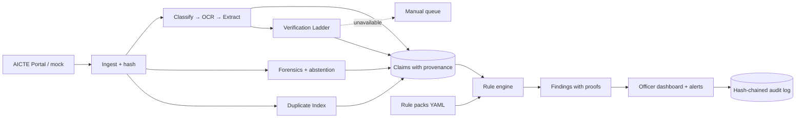

# Evidence-Linked Application Validation for AICTE Approvals

**SIH 2026 · PS ID 26261** · AI-Powered Application Validation, Document Authentication and Regulatory Compliance Verification
**Org:** AICTE (Regulation Bureau) · **Category:** Software · **Theme:** Smart Automation

> **Status:** this is a proposal. Nothing is built yet, and every number below is a target, not a result.
> ⚠️ items need verification (against the official SIH portal and the APH text) before we build.

---

## 1. The problem (in short)
AICTE officers check Extension-of-Approval (EoA) applications by hand: are documents present, valid, consistent and genuine? It is slow and repetitive, and problems are found late.
The PS rules we must respect: **decision-support only**, **no bypassing access controls**, **explainable and evidence-linked flags**, **audit trail + role-based access**, **human review before any adverse action**, **demo on synthetic/anonymized data only**.

## 2. Our idea
> **Every finding is a proof, not a score.** A small, replayable chain: *Handbook clause → rule → extracted claims (doc, page, box) → evidence → source response.* An officer can inspect, challenge and override it.

### Core pillars
| # | Pillar | In simple words |
|---|---|---|
| 1 | **Executable Handbook** | Rules are stored as versioned YAML files with a clause reference, not hard-coded. When the Handbook changes, we edit a file. |
| 2 | **Claim–Evidence Graph** | Every extracted value links to its document, page and bounding box. Contradictions across documents (and across institutions) show up as graph conflicts. |
| 3 | **Verification Ladder** | Verify as strongly as possible: digital signature/QR → issuer API → portal lookup → forensics only → human. Uses the six PS statuses and records source + timestamp. |
| 4 | **Forensics with abstention** | Tamper signals (PDF structure, ELA, fonts, metadata) are combined. When unsure, the system says "manual review required" instead of guessing. Always worded as an "indicator". |
| 5 | **Duplicate-Evidence Index** | Finds the same photo, certificate or floor plan reused across institutions or years. This only works for AICTE because it holds the whole corpus. |

### Extra differentiators (from our brainstorm)
| Idea | What it adds |
|---|---|
| **Proof-of-Presence photos** | Portal issues a random code to show in lab photos, plus EXIF/GPS and reuse checks. Output is "needs more evidence / consider inspection", never "fraud". |
| **Fault-injection benchmark** | We generate synthetic institutions with planted faults, so we can show real precision/recall per fault type. |
| **Institution pre-flight check** | Institutions see missing/expired items and how to fix them *before* submitting. Includes an expiry radar. |
| **Transparent triage** | Explainable risk factors route cases to desk review, clarification or inspection. Officers can override. |
| **Tamper-evident audit log** | Hash-chained log of rules run, sources checked and officer actions. |

**Not doing:** chatbot as a headline feature, blockchain, voice UI, or any automated approve/reject.

---

## 3. Existing solutions and the gap
| Source | What it does | Why it's not enough |
|---|---|---|
| DigiLocker / NAD | Issuer-signed documents verified via URI/QR | Covers only documents issued into it (many AICTE-file documents aren't). No cross-document or infrastructure reasoning. Production access needs onboarding. |
| Sentinel-AI, AstraShield, SIH fake-doc repos | Tamper/ID-fraud scoring (ELA, OCR, CNN) | Identity-document focus, single score, no regulatory rules or issuer verification. |
| DocTamper, ADCD-Net, redrob-verify | Research on tampered-text detection | Not a compliance engine. Weak generalization to AI-forged or Indian institutional documents. |
| AICTE-related student repos (doc verification, portal automation) | Upload + OCR + dashboard workflows | No rule provenance, no calibrated uncertainty. ⚠️ review quality and licences. |
| Commercial tools (Certta, Equifax) | Risk-scored tamper detection | Closed, not AICTE-rule-aware, not auditable by a regulator. |

**Gap:** in the sources we checked, none combines versioned executable rules, whole-application evidence reasoning, honest "I don't know → manual review", and cross-institution reuse detection. We don't claim global novelty. (Search was bounded; the team should run the GitHub queries and extend this table.)

---

## 4. Architecture

## 5. Features by priority
| Priority | Feature |
|---|---|
| **P0** | Category detection → checklist · OCR + field extraction with provenance · rule engine with proof traces · expiry and cross-document checks · Verification Ladder (mock adapters + one signature/QR check) · officer dashboard with evidence viewer and audit trail |
| **P1** | Forensic signals + abstention · Duplicate-Evidence Index · alerts · institution rectification/pre-flight check · synthetic benchmark + metrics page |
| **P2** | Proof-of-Presence photo check · floor-plan area check · rule-pack diff · risk triage · Handbook Q&A copilot |

## 6. Tech stack
| Layer | Choice |
|---|---|
| Frontend | Next.js + TypeScript + Tailwind, pdf.js for bounding-box overlays |
| Backend | Python FastAPI, Redis queue |
| OCR / extraction | PaddleOCR or docTR (Tesseract fallback); templates + regex first, schema-validated model as fallback |
| Rules | YAML rule packs + Python evaluator (Z3 for date/number constraints) |
| Forensics | OpenCV, pikepdf, exiftool, PyTorch baseline, conformal calibration |
| Verification | pyHanko (PDF signatures), QR decoding, mock issuer adapters ⚠️ confirm licences |
| Similarity | pHash, embeddings, SimHash, pgvector |
| Data | PostgreSQL, MinIO, Docker Compose |
| Security | JWT + RBAC, PII masking, encrypted storage, local models by default |

## 7. Verification statuses (as in the PS)
`VERIFIED` · `MISMATCH_DETECTED` · `EXPIRED` · `VERIFICATION_PENDING` · `SOURCE_UNAVAILABLE` · `MANUAL_REVIEW_REQUIRED`
The overall application status (e.g. "Ready for scrutiny", "Deficiencies flagged") is *derived*. It is never an approval or rejection.

## 8. Demo plan (about 7 minutes)
1. Upload a clean synthetic EoA bundle → "Ready for scrutiny", open the evidence viewer.
2. Upload a bundle with planted defects: expired fire certificate, missing affidavit page, intake mismatch, edited figure, photo reused from another institution.
3. Click each finding → rule, clause, claim boxes, source response, "advisory" tag.
4. Show the ladder: one verified, one mismatch, one source unavailable → manual queue.
5. Show a borderline scan where the system abstains and says why.
6. Change a rule tolerance → re-validate → audit trail shows what changed and who changed it.
7. Metrics slide: measured results on the synthetic set, plus honest failure cases.

## 9. Evaluation (🎯 targets, to be measured)
| Component | Metric | Target |
|---|---|---|
| Extraction | Field exact-match (digital PDFs) | ≥ 90% |
| Rule engine | Recall on seeded structural defects | ≥ 95% |
| Cross-document checks | Precision / recall | ≥ 90% / ≥ 90% |
| Tamper indicators | Beat ELA-only baseline | Report honestly, including cross-domain drop |
| Verification ladder | Correct status on scripted scenarios | 100% |
| Duplicate index | Recall on planted reuse | Report |
| Time / effort | Seconds per application, manual vs assisted | Report observed difference |

## 10. Risks and limits
| Risk | Mitigation |
|---|---|
| Rules mis-encoded | Clause link per rule, official review, unit tests |
| False tamper flags | Abstention, "indicator" wording, officer review |
| AI-forged docs evade forensics | Prefer cryptographic/source verification. Forensics is never the sole basis. |
| No real data or issuer access | Synthetic data + mock adapters, clearly disclosed |
| Legitimate document reuse (shared trust/campus) | Relationship allow-list + human review |
| Over-scoping | P0/P1/P2 priorities. No dependency on model training or live APIs. |

**We do not claim:** global novelty, achieved accuracy numbers, access to AICTE/DigiLocker/issuer systems, or that any document is *proven* forged.

## 11. Roadmap (6 weeks)
| Week | Milestone |
|---|---|
| 1 | Read the APH, pick 2–3 application categories, write the first rule pack, synthetic generator v0 |
| 2 | Ingestion, OCR, template extraction, claim store |
| 3 | Rule engine + proof traces, expiry/consistency checks, defect test suite |
| 4 | Verification Ladder, dashboard, evidence viewer |
| 5 | Forensics + abstention, duplicate index, alerts, audit log |
| 6 | Evaluation, failure cases, demo rehearsal, stretch (photo check / floor plan) |

## 12. Team to-do
- [ ] Confirm the PS ID, title and safeguards on the official SIH portal.
- [ ] Read the APH sections on EoA documents, faculty, infrastructure and intake. Verify every rule before encoding.
- [ ] Choose the 2–3 application categories for the MVP.
- [ ] Assign owners: rules/audit · OCR/extraction · forensics/CV · verification/graph · frontend · synthetic data + metrics.
- [ ] Run the GitHub prior-art searches and extend §3.

## References
- DigiLocker / NAD: https://nad.digilocker.gov.in/faq · https://verify.digilocker.gov.in/
- API Setu: https://api.apisetu.gov.in
- Sentinel-AI: https://github.com/sanashk19/Sentinel-AI
- DocTamper (CVPR 2023): https://openaccess.thecvf.com/content/CVPR2023/html/Qu_Towards_Robust_Tampered_Text_Detection_in_Document_Image_New_Dataset_CVPR_2023_paper.html
- AIForge-Doc: https://arxiv.org/abs/2602.20569
- ADCD-Net: https://github.com/KAHIMWONG/ADCD-Net
- AICTE Approval Process Handbook (verify current version): https://www.aicte.gov.in/sites/default/files/APH%20Final.pdf
