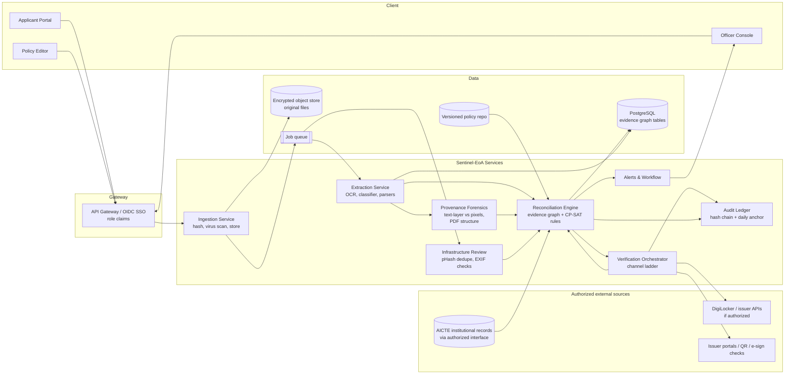

# Sentinel-EoA: Evidence-Graph Validation with Forensic Provenance for AICTE Approval Applications

> **Status: Design only.** No code has been implemented or tested yet. Every capability below is labelled either **[Planned]** (designed, not built) or **[Verified]** (checked against a public source during research). No accuracy figures in this document are experimental results.

| Field | Value |
|---|---|
| SIH Problem Statement ID | SIH26261 (as supplied by the team; not yet re-checked on the official SIH portal, see §1) |
| Title | AI-Powered Application Validation, Document Authentication and Regulatory Compliance Verification |
| Organization / Department | AICTE / Regulation Bureau |
| Category / Theme | Software / Smart Automation |

---

## 1. Problem Statement Details

**Source of record.** The details below were taken from the problem statement text supplied for this task. In this session I could not open the SIH portal or the browser tabs, so the ID and wording have not been re-verified against sih.gov.in. Confirm before submission.

**Core requirement in one sentence.** Build an AI-enabled decision-support platform, integrated with or designed for the AICTE portal, that validates Extension of Approval (EoA) and related applications and their documents against institutional records and configurable regulatory rules, detects anomalies and possible forgery as *preliminary* flags, routes verification to issuing authorities where possible, flags infrastructure gaps, and leaves every adverse decision with AICTE officials.

**Expected deliverables (from the statement).**
1. Functional prototype integrated with, or designed for, the AICTE portal.
2. Category-based checklists and configurable validation rules.
3. OCR-based classification, extraction and completeness checks.
4. Cross-document and institutional-record consistency checks with evidence-linked flags.
5. Document verification workflow using authorized issuing-authority sources.
6. Compliance-assistance module for documentary and infrastructure evidence.
7. Dashboard for status, deficiencies, verification outcomes, pending actions and audit history.
8. Role-based access, secure document handling, confidentiality, and human review before any adverse action.

**Hard constraints from the statement.** Statutory scrutiny, physical inspection and final decisions stay with AICTE. The system must not bypass access controls or assume access to restricted databases. AI output must be explainable and evidence-linked.

---

## 2. Executive Summary

Most approval workflows check documents one at a time: is the affidavit present, is the NOC dated, does the PDF look normal. That misses the failure mode that matters most in regulatory scrutiny, which is **disagreement between documents and records**. A faculty count in one annexure, an intake figure in a letter, and a built-up area in a building certificate can each look valid alone and be inconsistent together.

Sentinel-EoA treats an application as a **graph of typed evidence** rather than a folder of files. Each extracted fact is a node with provenance (which file, which page, which region, which extractor). Each handbook rule is a constraint over those nodes, written as data so AICTE can change it without a code release. Each rule run produces a **proof certificate** showing the inputs and the clause it applied, and a failed rule can name the minimal set of conflicting facts that caused it.

The solution adds a second, independent layer for the document files themselves. For machine-generated PDFs (EoA letters, certificates, many affidavits), the system compares the **embedded text layer** with **what the rendered page actually shows**, and inspects the PDF's internal structure. A figure that differs between the two is a strong, explainable overlay-edit indicator. This is cheap, does not need a large training set, and produces evidence a human reviewer can check in seconds.

Verification of the document's source is handled by a **channel ladder** (authorized API → official portal or QR → issuer reference-number lookup → manual confirmation) with explicit statuses, and every step is recorded in a **hash-chained audit ledger**.

**What this is not.** It is not a forgery verdict engine, a chatbot, a generic dashboard, or a blockchain registry. It produces flags and routes cases to officials.

---

## 3. Problem Definition

**Who is affected.** Applicant institutions (who wait for queries and resubmissions), AICTE Regulation Bureau scrutiny staff (who check each file by hand), and approving authorities (who receive files with unclear status).

**Where time is lost.**
- Missing or expired items are discovered late, after a full scrutiny pass.
- The same records (faculty lists, approved intake, prior EoA) are checked manually against documents that could be compared automatically.
- Document authenticity is checked by eye, or by writing to the issuing authority and waiting.
- Infrastructure evidence (photos, floor plans) is reviewed without a consistent checklist, so the same case can be judged differently by different officers.

**What the statement asks us to avoid.** Treating a flag as proof of misconduct, bypassing authorization, and automating the final decision.

---

## 4. Existing Solutions and Research Gap

### 4.1 Search scope and method (honest account)

- **Search queries run:** "SIH26261 AI-Powered Application Validation Document Authentication Regulatory Compliance AICTE"; "DigiLocker issuer API document verification partner onboarding"; "AICTE Extension of Approval EoA application portal approval process handbook 2026-27 documents"; "document tampering detection open source GitHub copy-move error level analysis benchmark DocTamper".
- **Sources actually read:** search-result excerpts and a set of public pages, including commercial product pages, DigiLocker partner pages, sample public EoA letters published by institutions, the CVPR 2023 DocTamper paper listing, and a 2025 arXiv forensics benchmark.
- **GitHub repositories:** **not inspected.** I did not open source code, READMEs, tests or licences for any repository. The only repository referenced in the sources I read is `github.com/qcf-568/DocTamper` (cited by the CVPR 2023 paper). Repository-level comparison is therefore listed as a **next step (§19, Phase 0)**, not as a finding.
- **Browser tabs / workspace:** not accessible in this session. No existing project repository was available to inspect or modify, so no `README.md` merge was performed. This file is a standalone deliverable.
- **Search coverage is not exhaustive.** The claims below about "no existing solution" mean that none turned up in these searches, not that none exists.

### 4.2 Prior art

| Prior art | What it actually does (from source) | Limitation for AICTE | Reuse decision |
|---|---|---|---|
| **SIH 2024, PS 1709 "Comprehensive Automated Document Verification System", team Tecxotic ("VeriChain")** | Proposes a frontend, backend, AI and blockchain system to verify and store official documents. | Different problem statement (generic verification), and blockchain is positioned as the core. Does not address regulatory rule sets, handbook checklists or government source reconciliation. | Avoid blockchain as the centrepiece. Note as a reference for judges who may have seen it. |
| **RippleHire Document Validation Agent** (commercial, HR) | OCR extraction, AI checks against a candidate profile and configured rules, Match / Attention / Approved status. | Built for hiring, not regulators. Its "attention" status is close to our flagging model, which validates the design pattern. | Pattern reference only. |
| **Twind AI** (commercial, HSE contractor compliance) | Document classification and validation with full logging; models hosted in EU. | Domain-specific expert review in the loop. No issuer-source verification. | Pattern reference only. |
| **DocVerify AI on AWS Marketplace** | Serverless multi-stage validation pipeline (DAG) checking completeness, page order and signatures for submitted bundles. | Structural QA only: checks that documents are present and ordered, not that values agree across documents or with records. | Pattern reference for the DAG-style validation pipeline. |
| **LTM SmartVal** (commercial, life-sciences CSV) | LLM multi-agent system for validation documentation. | Document generation for compliance, not checking submissions. | Not relevant beyond confirming demand. |
| **DigiLocker API ecosystem** (government; wrapped commercially by Gridlines, Cashfree, Meon, HyperVerge) | Government document wallet. Requesters must be registered and authorized; the user consents, then the requester fetches issued documents. Issuers such as UIDAI and the Income Tax Department participate. | Only documents that the issuer has pushed to DigiLocker can be fetched. Access requires authorization through the API Setu partner process. The partner-onboarding pages I read did not publish a fee schedule, lead time or sandbox. Not all AICTE document types are expected to be on it. | **Integrate as one channel** in the verification ladder, subject to AICTE or a registered partner being authorized. Do not depend on it. |
| **Research: DocTamper and DTD** (Qu et al., CVPR 2023; code at `qcf-568/DocTamper`) | 170,000-image dataset of document tampering (copy-move, splicing, generation) and a Document Tampering Detector using a frequency perception head and iterative multi-view decoder. The paper reports F-measure gains over prior state of the art. | Trained on pixels, so it is weak on re-scanned or phone-captured official documents and cannot explain its decision in human terms. Dataset licence not verified in this session. | Use as an **optional secondary pixel-level model**, after verifying licence and reproducing results. |
| **ForensicHub** (arXiv 2025 benchmark) | Unified benchmark and codebase for fake image detection and localization across domains, including documents (DocTamper, T-SROIE, RTM). | Benchmark, not an application. Useful for evaluation protocol. | Evaluation reference. |

### 4.3 The gap

Across the sources above, I found the following combinations **not** present together:

1. **Regulatory rules as configurable, explainable constraints over facts drawn from several documents and authorized records**, not single-document presence checks.
2. **Forensic checks tuned to machine-generated official documents**, where the text layer and the visible page are expected to agree and where structural PDF anomalies are informative.
3. **Explicit reprint-aware temporal logic.** Official letters carry a "Letter Printed On" date that is later than the approval date. A naive date check would flag them. I observed this in public sample letters (approval dates in March 2026, print dates into June 2026). The system must separate issue date, print date, validity window and expiry.
4. **A verification ladder with per-channel status** (verified, mismatch, expired, pending, source unavailable, manual review) and an audit trail that a regulator can verify independently.

I make no claim that these ideas are new to the research literature. Item 2 combines known forensic techniques in a new setting, and needs a literature check before it is presented as novel (§19, Phase 0).

---

## 5. Proposed Solution and Core Innovation

### 5.1 Three candidate approaches

**Approach A: OCR plus rules checklist engine.** OCR extraction, a classifier for document types, and per-category checklists in a configuration file. *Problem solved:* missing and expired items. *Gap:* does not catch cross-document contradictions or forged content. *Technology:* PaddleOCR or Tesseract, rules in YAML, FastAPI. *Difficulty:* low. *Risk:* commodity, hard to differentiate. *Measurement:* field-extraction F1, checklist agreement with human scrutiny on a labelled set.

**Approach B: Pixel-level tamper detection on every upload.** A DocTamper-style network with localization masks over all scanned documents. *Problem solved:* visual alterations. *Gap:* no explanation beyond a heatmap; weak on re-scans and phone photos; needs labelled tampering data that AICTE does not have. *Technology:* PyTorch, a segmentation backbone, DocTamper-style data synthesis. *Difficulty:* high. *Risk:* high false-positive rate on legitimate scans; cannot be evaluated on real AICTE cases without authorization. *Measurement:* pixel-level F-measure on held-out synthetic and public data, plus false-positive rate on clean scans.

**Approach C (selected): Evidence graph with constraint reconciliation and provenance forensics.** Facts from documents and authorized records become typed, provenance-tagged nodes. Handbook rules are constraints over those nodes, solved with an explicit proof. A provenance module checks each machine-generated PDF for text-layer and visual disagreement and for structural anomalies, with pixel models used only as a fallback.

### 5.2 Comparison

Scores are the team's assessment on a 1–10 scale, not measured results. Weighted totals use the weights supplied in the task.

| Criterion | Weight | A | B | C |
|---|---|---|---|---|
| Alignment with official problem | 20% | 7 | 5 | 9 |
| Innovation and differentiation | 20% | 3 | 6 | 8 |
| Technical depth | 20% | 4 | 8 | 8 |
| Real-world impact | 15% | 6 | 5 | 8 |
| Prototype feasibility | 10% | 9 | 4 | 7 |
| Data and validation feasibility | 10% | 7 | 4 | 7 |
| Cost and deployment practicality | 5% | 9 | 5 | 7 |
| **Weighted total (out of 100)** | | **57.5** | **56.0** | **79.5** |

Approach C is selected. It scores highest on the criteria the statement emphasizes (alignment, explainability, evidence linkage). Approach B is the most technically risky, so it is kept as an optional fallback inside C rather than the core.

### 5.3 Core innovations of the selected approach

**I1. Typed evidence graph with handbook-as-code constraints and proof certificates.**
Each application becomes a graph. Node types include Institution (Permanent ID), Application (Application ID), Programme/Intake, Faculty member, Building/Land, Document instance, Issuer, and Authorization record. Each extracted value carries provenance: source file hash, page, bounding box, extractor and confidence. Rules are declared in a versioned YAML/JSON policy file that cites the handbook clause. Numeric and set constraints (for example, faculty count meets the requirement for intake; approved intake this year does not exceed the approved intake in the authoritative prior record, where the handbook allows) are checked with a constraint solver (OR-Tools CP-SAT). A violated rule returns a **minimal conflicting set** of facts, so an officer sees exactly which two numbers disagree and where each came from.

**I2. Provenance forensics for machine-generated PDFs.**
Official letters, certificates and many affidavits are produced by software, so their internal structure is predictable. Two checks run on them:

- *Text-layer versus pixel divergence.* Render each page, run OCR on the rendered regions, and compare token by token with the embedded text layer. Where the text layer says one value and the pixels show another, an overlay or regeneration has likely happened. The finding carries both values and a page image crop.
- *Structural anomaly scoring.* Inspect the PDF with a parser (qpdf / pikepdf): number of incremental-update sections, object streams, producer and creator strings against values seen in known-good samples, font subset names that differ within one document, text objects placed over image regions, and creation or modification dates that are out of order.

Each indicator is weighted and reported with its evidence. The output is labelled **"indicator requiring verification"**, never "forged".

**I3. Reprint-aware temporal reasoning.**
Each date is typed: issue date, print date, validity start, validity end, expiry, submission date. Rules reference the typed date they need. Print dates are metadata and cannot trigger an expiry or date-mismatch rule on their own. This directly addresses the reprint pattern seen in public EoA letters.

**I4. Verification ladder with an audit ledger.**
For each document type the platform keeps an ordered list of verification channels:

1. Authorized API (for example, a registered DigiLocker issuer or requester channel, where AICTE is authorized).
2. Official portal, QR code, digital signature validation, or unique reference-number lookup.
3. Issuer confirmation through a logged request, with the response stored.
4. Manual confirmation by an official.

The case moves down the ladder only when a channel is unavailable or inconclusive. Each attempt records channel, timestamp, request identifier, response hash and result. Audit entries are chained by hash (each entry includes the hash of the previous one), and the chain head is anchored daily in a signed record, so tampering with the log is detectable.

### 5.4 Why this is hard enough

The difficulty is in the reconciliation logic and the provenance evidence, not in calling an OCR API. Rule conflicts between handbook clauses, documents that disagree with a record in the authorized store, and legitimately reprinted letters are all cases where a naive system produces wrong answers. Handling them correctly and explaining each result is the measurable part of the project.

---

## 6. Differentiation From Comparable Projects

| Dimension | Typical document-validation product | Sentinel-EoA |
|---|---|---|
| What is checked | Presence, completeness, page order | Presence plus value agreement across documents and against authorized records |
| Rules | Fixed or prompt-based | Versioned policy file tied to handbook clauses, solved with explicit constraints |
| Explanation | Confidence score or Match/Attention label | Minimal conflicting fact set with provenance and page crop |
| Forgery signal | Pixel heatmap or none | Text-layer/pixel divergence and PDF structure indicators; pixel model as fallback |
| Dates | Single "date" field | Typed dates, reprint-aware |
| Source verification | Not included, or single API | Ordered channel ladder with per-channel status |
| Audit | Activity log | Hash-chained, daily-anchored ledger |
| Regulator control | Vendor-defined rules | Officials edit rules through a governed change process |

---

## 7. Features and Target Users

### 7.1 Users and roles

| Role | Access | Main tasks |
|---|---|---|
| Applicant (institution) | Own applications only | Upload, see deficiencies, rectify where the process allows |
| Scrutiny officer | Assigned applications | Review flags, accept or dismiss with reason |
| Verification officer | Verification queue | Run or confirm source checks, record outcomes |
| Senior approver | Full case view | Final decision; cannot be auto-triggered by the system |
| Policy administrator | Rule and checklist configuration | Publish rule versions with approval workflow |
| Auditor | Read-only audit and ledger | Verify chain integrity, export evidence |

### 7.2 Feature list

**[Planned]**
- Application category detection and checklist selection.
- Document classification and field extraction with confidence and provenance.
- Completeness, expiry and cross-document consistency checks through the evidence graph.
- Provenance forensics for machine-generated PDFs (I2).
- Verification ladder with status per channel (I4).
- Infrastructure evidence review: duplicate-photo detection across applications via perceptual hashing, EXIF timestamp and location plausibility where metadata exists, and a checklist of visible items (for example, lab equipment, classrooms, library) that a reviewer confirms. Visual items are advisory and marked for physical inspection when uncertain.
- Dashboard with status, deficiencies, pending verifications and inspection queue.
- Alerts (email and in-app) for missing items, expiries, pending source checks and unresolved flags.
- Full audit export.

**[Verified only as design intent, not built]** Everything above.

---

## 8. System Architecture



**Notes on the diagram.** Arrows to AICTE records and external sources are **[Planned]** and depend on authorization. The Verification Orchestrator never reaches an external source that AICTE has not authorized. Every service writes to the audit ledger.

---

## 9. Technology Stack

| Layer | Choice | Why this, not the alternative |
|---|---|---|
| Backend API | Python 3.12, FastAPI | Mature for ML-adjacent services; typed request models; easy OpenAPI docs for SIH judges |
| Background jobs | Redis + RQ | Simpler to run than Celery for a prototype; enough for document batch jobs |
| OCR | PaddleOCR (primary), Tesseract (fallback) | PaddleOCR is stronger on mixed layouts; Tesseract is a lightweight fallback. Test both on synthetic Indian-format documents |
| PDF parsing and rendering | PyMuPDF (text layer, rendering), pikepdf / qpdf (structure) | Two independent views of the same file are what I2 needs |
| Rule engine | OR-Tools CP-SAT | Explicit constraint solving with infeasibility explanations; avoids opaque ML for rules that must be audited |
| Evidence graph storage | PostgreSQL tables (nodes, edges, provenance) | One database to operate; graph queries are shallow enough for SQL with recursive CTEs |
| Perceptual hashing | `imagehash` (pHash, dHash) | Standard, fast, interpretable for duplicate-photo detection |
| Optional pixel forensics | PyTorch, segmentation model trained on DocTamper-style data | Only after licence verification and reproduction (Phase 3) |
| Frontend | React + Vite, a component library with accessible defaults | Officer console needs tables, diff views and page crops |
| Object storage | S3-compatible (MinIO for prototype) with server-side encryption | Keeps the same interface for on-premise government deployment |
| Auth | OIDC with role claims; mock IdP for demo | Matches typical government SSO; the real IdP is to be confirmed with AICTE |
| Containers | Docker Compose (prototype), Kubernetes or on-premise VMs (production) | Compose is enough for the demo; production hosting is for AICTE to decide |

Technologies were chosen for the problem. None were picked because they are fashionable, and no large language model is needed for the core validation path. A language model may be used later for drafting officer-facing summaries, but never to make a determination.

---

## 10. Algorithms, Data and Methodology

### 10.1 Extraction and classification

- **Input:** page images and, where present, PDF text layers.
- **Classification:** document type from a small CNN or from layout and keyword features, with a reject class for unknown documents. **Baseline:** keyword-and-layout rules. **Metric:** macro F1 by document type.
- **Extraction:** OCR with template-guided regions for known official layouts, and key-value extraction for free-form affidavits. **Baseline:** full-page OCR with regex. **Metric:** field-level exact match and F1 on a labelled set.
- **Outputs per field:** value, normalized value, page, bounding box, extractor, confidence.

### 10.2 Rules and reconciliation

- Policies are versioned files: `rule_id`, `handbook_clause`, `applies_to_category`, `inputs` (typed nodes), `constraint`, `severity`, `effective_from`, `effective_to`.
- At run time, the engine loads the policy version in force on the application's submission date, builds the evidence graph, and solves each rule.
- **Output:** pass, fail, or not evaluable (missing input). Failures include the minimal conflicting set. Not-evaluable results trigger a deficiency rather than a failure.
- **Example rules (illustrative; to be checked against the current handbook):** approved intake in the EoA request does not exceed the authoritative prior record where the handbook allows; faculty qualification count meets the requirement for the programme; affidavit date falls within the window set by the policy; NOC validity end is after the decision date.
- **Baseline:** a hand-coded checklist. **Metric:** agreement with officer decisions on the labelled set, and count of conflicts found that officers missed.

### 10.3 Provenance forensics

- **Text-layer divergence:** for each text token in the layer, find its bounding box in the rendered page, OCR the crop, and compare. Score = proportion of numeric and identifier tokens that disagree. Scanned documents with no text layer are skipped (not flagged).
- **Structural indicators:** list of features with weights set on synthetic samples and recalibrated on any authorized real samples. Weights are published in the policy file so the scoring is inspectable.
- **Baseline:** no forensic check. **Metric:** precision and recall on a synthetic set of genuine and altered documents, with alteration types defined in advance (value change, identifier change, date change, overlay with a font mismatch, re-printed page).

### 10.4 Pixel forensics (optional, Phase 3)

- A segmentation model producing a tamper mask, used only when §10.3 is inconclusive on a scanned document.
- **Training data:** DocTamper (licence to verify) and synthetic tampering generated by the team.
- **Baseline:** the mask produced by simple error-level analysis. **Metric:** pixel-level F-measure and image-level false-positive rate on clean scans.

### 10.5 Infrastructure review

- Duplicate photo detection with pHash across applications, to flag reuse of the same image for different institutions.
- EXIF time and location checks where metadata is present. Absence of metadata is not a finding.
- Checklist-based visual confirmation by a reviewer, with the model proposing items and a reviewer confirming them. A model-only "compliant" result is never produced.

### 10.6 Validation metrics

| Component | Metric | Baseline |
|---|---|---|
| Classification | Macro F1 | Keyword rules |
| Extraction | Field F1 | Full-page OCR + regex |
| Rules | Agreement with officer decisions | Hand checklist |
| Conflict detection | Conflicts found, precision | Document-by-document checks |
| Provenance forensics | Precision and recall on constructed alterations | No forensic check |
| Source verification | Share of cases resolved by automated channel | Manual only |
| Processing | Median time per application | Manual scrutiny time (to be measured with officers) |

---

## 11. Hardware Design

Not required. The system is software-only. The infrastructure review module uses photos and PDFs submitted by institutions. Optional guidance for capture (for example, a checklist of angles and lighting) can be shown in the applicant portal.

---

## 12. Database and API Design

### 12.1 Core tables [Planned]

| Table | Key columns | Notes |
|---|---|---|
| `institution` | `permanent_id` (PK), name, state, region | Mirrors authorized records, read-only in the prototype |
| `application` | `application_id` (PK), `permanent_id`, category, status, submitted_at | |
| `document` | `doc_id`, `application_id`, sha256, type, storage_key, uploaded_by | Hash is the integrity anchor |
| `page` | `doc_id`, `page_no`, render_hash, has_text_layer | |
| `field_value` | `value_id`, `doc_id`, `page_no`, bbox, field_key, raw, normalized, extractor, confidence | Provenance |
| `graph_node` | `node_id`, type, key, attrs | Typed evidence nodes |
| `graph_edge` | `from_node`, `to_node`, relation, source_value_id | |
| `policy_version` | version, content_hash, effective_from, approved_by | Immutable once published |
| `rule_result` | run_id, rule_id, policy_version, result, conflict_set, certificate | Proof record |
| `forensic_finding` | finding_id, doc_id, kind, weight, evidence_ref | Always advisory |
| `verification_attempt` | attempt_id, doc_id, channel, request_id, response_hash, status, at | Per-channel result |
| `audit_entry` | seq, actor, action, payload_hash, prev_hash, at | Hash chain |
| `alert` | alert_id, application_id, kind, state, owner | |

### 12.2 API endpoints [Planned]

| Method | Path | Purpose |
|---|---|---|
| POST | `/api/v1/applications` | Create or link an application from the AICTE portal |
| POST | `/api/v1/applications/{id}/documents` | Upload a document; returns hash and job id |
| GET | `/api/v1/applications/{id}/validation` | Latest validation report |
| GET | `/api/v1/applications/{id}/graph` | Evidence graph view for the console |
| GET | `/api/v1/findings/{finding_id}` | Finding with evidence and page crop reference |
| POST | `/api/v1/applications/{id}/verify` | Start the verification ladder for a document |
| POST | `/api/v1/findings/{finding_id}/disposition` | Officer accepts, dismisses or escalates, with reason |
| GET | `/api/v1/policies` / POST `/api/v1/policies` | List and propose policy versions (approval required) |
| GET | `/api/v1/audit/export` | Auditor export with chain verification result |

All endpoints require a role claim. Disposition and policy publication require a second approver.

---

## 13. Installation and Setup

> **[Planned]** These steps describe the intended setup. They have not been run because the code does not exist yet.

```bash
# 1. Clone the repository (URL to be set after creation)
git clone <REPOSITORY_URL> sentinel-eoa
cd sentinel-eoa

# 2. Copy environment template and fill in placeholders
cp .env.example .env

# 3. Start infrastructure (PostgreSQL, Redis, MinIO) and services
docker compose up -d

# 4. Apply database migrations
docker compose run --rm api alembic upgrade head

# 5. Load synthetic demo data (no real institutional data)
docker compose run --rm api python -m scripts.load_synthetic --scenario all

# 6. Open the console
#    Applicant portal: http://localhost:<PORTAL_PORT>
#    Officer console:  http://localhost:<CONSOLE_PORT>
```

**Local development without containers [Planned]:** Python 3.12 virtual environment, `pip install -r requirements.txt`, `pytest`, and `npm ci && npm run dev` for the frontend.

---

## 14. Environment Variables

All values are placeholders. Do not commit real values.

```dotenv
# Application
APP_ENV=development
APP_SECRET_KEY=<GENERATE_RANDOM_SECRET>
APP_BASE_URL=<PUBLIC_BASE_URL>

# Database
DATABASE_URL=postgresql+psycopg://<DB_USER>:<DB_PASSWORD>@<DB_HOST>:<DB_PORT>/<DB_NAME>

# Queue
REDIS_URL=redis://<REDIS_HOST>:<REDIS_PORT>/0

# Object storage (encrypted at rest)
OBJECT_STORE_ENDPOINT=<OBJECT_STORE_ENDPOINT>
OBJECT_STORE_BUCKET=<BUCKET_NAME>
OBJECT_STORE_ACCESS_KEY=<ACCESS_KEY>
OBJECT_STORE_SECRET_KEY=<SECRET_KEY>
OBJECT_STORE_KMS_KEY_ID=<KMS_KEY_ID>

# Identity (OIDC)
OIDC_ISSUER_URL=<OIDC_ISSUER_URL>
OIDC_CLIENT_ID=<OIDC_CLIENT_ID>
OIDC_CLIENT_SECRET=<OIDC_CLIENT_SECRET>

# Authorized external sources (leave empty until authorized)
AICTE_RECORDS_API_URL=<AUTHORIZED_AICTE_RECORDS_ENDPOINT>
AICTE_RECORDS_CLIENT_CERT_PATH=<PATH_TO_CLIENT_CERT>
DIGILOCKER_CLIENT_ID=<DIGILOCKER_CLIENT_ID>
DIGILOCKER_CLIENT_SECRET=<DIGILOCKER_CLIENT_SECRET>

# Audit ledger
AUDIT_ANCHOR_SIGNING_KEY_REF=<HSM_OR_KMS_KEY_REFERENCE>
AUDIT_ANCHOR_INTERVAL=daily

# Feature flags
ENABLE_PIXEL_FORENSICS=false
ENABLE_INFRA_REVIEW=true
```

---

## 15. Project Structure [Planned]

```
sentinel-eoa/
├── README.md
├── docs/
│   └── research-and-prior-art.md      # detailed research log (Phase 0 to be completed)
├── policies/                          # versioned rule and checklist files
│   ├── eoa-2026-27/
│   │   ├── categories.yaml
│   │   ├── rules.yaml
│   │   └── forensic_weights.yaml
├── services/
│   ├── api/                           # FastAPI app, routers, auth
│   ├── ingestion/                     # hashing, malware scan, storage
│   ├── extraction/                    # OCR, classifier, template parsers
│   ├── forensics/                     # text-layer divergence, PDF structure
│   ├── reconciliation/                # evidence graph, CP-SAT rules, certificates
│   ├── verification/                  # channel ladder and adapters
│   ├── infra_review/                  # pHash dedupe, EXIF, checklist
│   ├── alerts/
│   └── audit/                         # hash chain, anchoring, verifier
├── console/                           # React officer and applicant UI
├── scripts/
│   ├── synth/                         # synthetic document and record generator
│   └── load_synthetic.py
├── data/
│   └── synthetic/                     # generated; never real records
├── tests/
│   ├── unit/
│   ├── rules/                         # one test per rule, including conflict cases
│   ├── forensics/                     # constructed alterations
│   └── e2e/
├── migrations/
├── docker-compose.yml
├── .env.example
└── requirements.txt
```

---

## 16. Testing and Validation Plan

### 16.1 Data

- **Synthetic application set (primary).** Generated by `scripts/synth` from templates modelled on public EoA letter layouts. Includes genuine and altered variants with the alteration type recorded as ground truth. No real institution data is used or stored.
- **Public samples (layout reference only).** Publicly posted EoA letters show the layout and fields. They contain institution identifiers and personal data, so they are used only to design templates and are not committed to the repository.
- **Authorized records (future).** Only with written authorization from AICTE. Not assumed.
- **Research data.** DocTamper for pixel-level experiments, subject to licence check.

### 16.2 Test levels

| Level | What is tested | Pass condition (proposed target) |
|---|---|---|
| Unit | Parsers, date typing, hash chain | 100% of unit tests pass |
| Rule | One test per rule, including conflict and not-evaluable cases | Every rule has a pass case, a fail case and a not-evaluable case |
| Forensic | Constructed alterations of each type | Target recall of 0.90 or more on value and identifier alterations; false-positive rate target below 0.05 on genuine synthetic documents |
| Extraction | Labelled synthetic set | Target field F1 of 0.95 or more on printed synthetic documents; lower target on photographed documents, to be set after first run |
| End-to-end | Demo scenarios (§20) | Each scenario produces the expected status and evidence |
| Audit | Chain verification after random tampering of a copy | Verifier detects every modified entry |
| Security | OWASP ASVS checks, role-access tests, upload fuzzing | No unauthorized access in role tests |

**Important.** The targets above are proposals for acceptance. They are not results. Results will be reported separately once measured, with the dataset version and code commit.

### 16.3 Acceptance criteria

1. Every adverse finding links to at least one page crop or field value with provenance.
2. No automated output sets a status of "forged", "fraud" or "rejected". Only flags and deficiencies are produced.
3. A reprinted letter with an unchanged approval date produces no date-related flag (regression test).
4. Every verification attempt records channel, timestamp and result, and appears in the audit chain.
5. Policy changes cannot take effect without a second approver.
6. Synthetic demo runs end to end on a clean machine using only the documented setup steps.

---

## 17. Security, Privacy, Limitations and Risks

### 17.1 Security and privacy design [Planned]

- Role-based access enforced at API and database layers; institution users see only their own applications.
- Files encrypted at rest; transport TLS only; virus scan on upload; original file hash stored and checked on every read.
- Access logging for every read of personal data.
- Data minimization: the graph stores extracted values needed for rules, not full documents, where possible. Retention periods are configurable and must be set by AICTE under applicable law (the Digital Personal Data Protection Act, 2023 applies to personal data; applicability and obligations to be confirmed with legal counsel).
- No external call is made unless its endpoint and credentials are configured. The system does not scrape portals or bypass authentication.
- Upload-level defences against malicious PDFs (sandboxed parsing, page and size limits).

### 17.2 Limitations

- **Forensic indicators are not proof.** A scan, a phone photo or a re-export can produce every indicator without any alteration. Outputs are labelled as indicators.
- **Text-layer check needs a text layer.** Pure scans fall back to pixel checks, which are weaker.
- **Rule accuracy depends on policy quality.** A wrong handbook reading produces systematic wrong flags. Mitigated by versioning, approval, and an officer override with reason.
- **Source verification depends on access.** Without an authorized channel for a document type, the case goes to manual confirmation.
- **Handbook references are inconsistent across public sources.** For example, the public notice I read refers to the Approval Process Handbook 2024-25 to 2026-27, while the approval letters I read refer to 2024-25 to 2027. The policy file must record which version applies, and the team should confirm with AICTE.
- **Synthetic data may not reflect real variation.** Results on synthetic data are not evidence of real-world accuracy.

### 17.3 Risks

| Risk | Likelihood | Impact | Mitigation |
|---|---|---|---|
| Access to AICTE records or verification APIs is not granted | High | High | Design works on uploads with manual channels; demo uses clearly labelled mock adapters |
| False alarms from reprinted or re-scanned legitimate documents | Medium | High | Reprint-aware dates; forensic output is advisory; calibration on authorized samples |
| Officers over-trust a flag | Medium | High | Show evidence first; require disposition with reason; training material |
| Policy drift between handbook and configuration | Medium | High | Versioned policies with approval and effective dates |
| Licence issue with research datasets | Medium | Medium | Verify licences; avoid dataset dependency for core features |
| Scope overreach into adjudication | Medium | High | Hard acceptance criterion 2; no adverse action path in code |
| Government hosting and data localization requirements | Medium | High | Confirm with AICTE and MeitY guidance; design for on-premise deployment |

---

## 18. Cost and Resource Requirements

**Prototype (SIH demo).** Runs on a single developer laptop or one small cloud VM. Open-source stack. No paid APIs are required. Estimated cost: near zero beyond developer time, subject to the cloud choice.

**Team.** Suggested split for a 6-person team: backend and data (2), extraction and forensics (2), frontend and demo (1), project and documentation (1). Figures are planning estimates, not measured.

**Production (indicative, for AICTE discussion).** Application servers, PostgreSQL with backups, encrypted object storage, HSM or KMS for audit anchors, monitoring, and a security assessment before go-live. Sizing depends on annual application volume, which should be requested from AICTE. No cost figures are asserted here.

**Hardware.** None.

---

## 19. Implementation Roadmap

| Phase | Duration (planning estimate) | Deliverables | Exit criterion |
|---|---|---|---|
| **0. Research completion** | 1 week | Open the repositories listed in §4; record licences and behaviour; literature check on text-layer divergence for official documents; confirm handbook version; confirm DigiLocker and AICTE integration routes with the team's mentor | Research log in `docs/research-and-prior-art.md`; go/no-go on each channel |
| **1. Data and policy** | 1–2 weeks | Synthetic generator; two application categories; policy v1 with about 15 rules, each citing a clause | Labelled synthetic set generated with ground truth |
| **2. Core validation** | 2–3 weeks | Ingestion, extraction, evidence graph, CP-SAT rules with certificates, console for scrutiny | Rule tests pass; demo scenarios 1–3 run |
| **3. Forensics and verification** | 2–3 weeks | Text-layer divergence, PDF structure indicators, verification ladder with mock adapters, audit chain | Forensic test set run; audit verifier passes |
| **4. Infrastructure review and dashboard** | 1–2 weeks | pHash dedupe, checklist review, alerts, dashboard | Demo scenarios 4–6 run |
| **5. Hardening and evaluation** | 1–2 weeks | Security checks, evaluation report with measured results, optional pixel model if licence allows | Evaluation report with dataset and commit identifiers |
| **6. Demo preparation** | 1 week | Scripted demo, slide deck, short video | Rehearsal complete |

---

## 20. SIH Demonstration Strategy

All scenarios use synthetic data and are labelled as such on screen.

1. **Missing and expired items.** An application with a missing affidavit and an NOC whose validity ends before the decision date. Shows deficiencies with evidence and an alert.
2. **Cross-document conflict.** The EoA request states an intake figure that differs from the figure in the supporting annexure. The console shows the minimal conflicting set and both page crops.
3. **Overlay edit.** A synthetic letter whose embedded text says one intake figure while the rendered page shows another. Shows the text-layer divergence and the page crop, labelled as an indicator requiring verification.
4. **Reprinted letter, no false alarm.** The same letter reprinted months after approval. Shows that the reprint-aware date logic produces no flag.
5. **Verification ladder.** A document with a QR code. The mock adapter returns a match; a second document has a source-unavailable response, which routes to manual confirmation. Both attempts appear in the audit chain.
6. **Infrastructure review.** Two applications use the same laboratory photograph. Shows the pHash duplicate flag, and a checklist item marked for physical inspection.

**Closing demonstration.** Show the audit verifier detecting a single edited audit entry, to make the traceability claim concrete.

**Honesty in the demo.** Adapters for external sources are mocks and will be labelled as such. No accuracy numbers are shown unless they have been measured and the measurement is on screen.

---

## 21. Prior-Art Comparison and References

The comparison table is in §4.2. The sources below were read during research.

1. SIH 2024, Problem Statement ID 1709, "Comprehensive Automated Document Verification System for Official Documentation", team Tecxotic. Slide deck: https://www.slideshare.net/slideshow/sih2024_idea_presentation_template-for-blockchain-based-project/276997941
2. RippleHire, Document Validation Agent: https://www.ripplehire.com/ai/agents/document-validation
3. Twind AI: https://twind.io/twind-ai/
4. DocVerify AI on AWS Marketplace: https://aws.amazon.com/marketplace/pp/prodview-ntvrzyyzju2hi
5. LTIMindtree SmartVal on Microsoft Marketplace: https://marketplace.microsoft.com/et-ee/product/ltim.ltimindtree_dataandai_computersystemvalidation
6. DigiLocker API overview and partner notes (third-party summary): https://didit.me/blog/digilocker-api/
7. DigiLocker partner onboarding (API Setu): https://api.apisetu.gov.in
8. Commercial DigiLocker wrappers (for context on the channel, not endorsements): https://gridlines.io/products/digilocker ; https://cashfree.com/digilocker-api ; https://meon.co.in/digilocker-api
9. AICTE Extension of Approval letters (public examples, layout reference only): for example https://cvru.ac.in/PDFDoc/CvruApprovalLetters/AICTE_EoA26-27.PDF and https://www.jagannath.org/images/EOA Report 2026-27.PDF
10. AICTE public notice for Approval Process 2026-27 (portal opening and handbook reference): https://bteup.ac.in/PDFFILES/NEWS_639005651817728160.pdf
11. Qu et al., "Towards Robust Tampered Text Detection in Document Image: New Dataset and New Solution", CVPR 2023. Paper and code: https://cvpr.thecvf.com/virtual/2023/poster/21237 ; https://github.com/qcf-568/DocTamper
12. ForensicHub: A Unified Benchmark & Codebase for All-Domain Fake Image Detection and Localization (arXiv 2025): https://arxiv.org/pdf/2505.11003
13. OR-Tools CP-SAT solver documentation: to be cited from the official site after verification in Phase 0.
14. Digital Personal Data Protection Act, 2023 (India): to be cited from the official gazette text after verification in Phase 0.

---

## Appendix A. Status Summary

| Item | Status |
|---|---|
| Problem statement details | Taken from supplied text; not re-verified on the SIH portal |
| Prior-art research | Search-based; GitHub repositories not inspected |
| Architecture and design | Complete (this document) |
| Source code | Not started |
| Tests and metrics | None run; all targets are proposals |
| Deployment | None |
| Screenshots and demo video | None; will be produced only from the working prototype |
