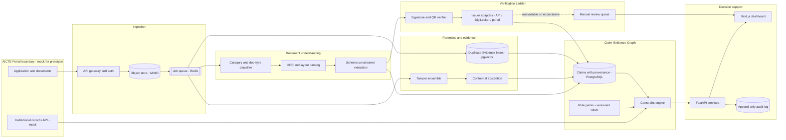

# PRAMAAN — Proof-Carrying Application Validation for AICTE Approvals

> **Merged team proposal:** combines PRAMAAN's proof-carrying validation architecture with TRACE's evidence-first framing and the strongest feasible parts of DOCGUARD, RULETRACE and EVIDENCE-LINK. This is a proposal, not an implemented system.

> **SIH 2026 · Problem Statement ID 26261** · *AI-Powered Application Validation, Document Authentication and Regulatory Compliance Verification*
> **Organization:** AICTE (Ministry of Education, GoI) · **Department:** Regulation Bureau · **Category:** Software · **Theme:** Smart Automation

**Status legend used throughout this document**

| Tag | Meaning |
|---|---|
| 🟦 **PLANNED** | Designed, not yet built. *Everything in this README is currently PLANNED — no code, model, accuracy figure or screenshot exists yet.* |
| 🟩 **IMPLEMENTED** | Built and demonstrably working (none yet) |
| 🎯 **TARGET** | A proposed acceptance threshold, **not** an achieved result |
| ⚠️ **VERIFY** | A fact we could not fully confirm during research and must check before building |

---

## 0. Verification notes on the problem statement (read first)

- The problem-statement text (ID 26261, title, department, category, theme, objectives, deliverables, safeguards) was taken from the problem-statement document our team shared. A third-party SIH tracking dashboard also lists ID 26261 with the same title ([dashboard](https://sih.mitrai.social/)), but this is **not a substitute for the official team workspace**. ⚠️ Confirm the exact ID/title and safeguards in the official SIH portal before final submission.
- The statement's own safeguards are binding design constraints for us: **decision-support only**, **no bypass of access controls**, **explainable, evidence-linked flags**, **role-based access + audit trail**, **human review before any adverse action**, **demo only on authorized/anonymized/synthetic data**.
- Handbook clauses (Approval Process Handbook 2024-27) were **not** read in full. Checklist items below are drawn from AICTE-generated Extension-of-Approval (EoA) letters, an AICTE affidavit template, and a state technical-education circular quoting APH requirements. ⚠️ **VERIFY every rule against the APH text and its corrigenda before encoding it.**

---

## 1. Executive summary

AICTE officials scrutinise Extension-of-Approval (EoA) applications by hand: they check whether affidavits, fire-safety certificates, NOCs, accreditation records, faculty data and infrastructure evidence are present, valid, mutually consistent and genuine. The work is repetitive, and errors surface late.

**PRAMAAN** does not try to be "a forgery-detector with a dashboard". Its central idea is different:

> **Every finding the system produces is a *proof* — a small, replayable chain of (handbook clause → machine-readable rule → extracted claims → pixel-level evidence → authoritative-source response) that an official can inspect, challenge and override.**

It combines five technically hard pieces into one pipeline:

1. **Executable Handbook** — AICTE rules as versioned, effective-dated, machine-readable data (not hard-coded `if` statements), evaluated by a constraint engine that emits proof traces.
2. **Claim–Evidence Graph** — every extracted value is a *claim* tied to a document, page and bounding box; contradictions across documents are graph constraints, not string comparisons.
3. **Verification Ladder** — a pluggable issuer-adapter layer that climbs from cryptographic verification (digital signatures, QR/URI) to official-source lookup to forensics-only to human review, and reports the exact PS-mandated statuses.
4. **Forensic ensemble with calibrated abstention** — tamper signals are fused and passed through *conformal prediction*, so the system flags only when it can bound its false-flag rate and otherwise says "manual review required" instead of guessing.
5. **Duplicate-Evidence Index** — perceptual-hash/embedding/text-fingerprint search across *all* submissions to find the same photo, certificate or floor plan reused across institutions or years. This is only possible for a body that holds the whole corpus, which is AICTE's unique position.

Outputs are advisory. Final scrutiny, inspection and decisions remain with AICTE officials.


### Synthesis of both team drafts: what we keep and what we defer

The team compared the **TRACE** concept (evidence graph + versioned compliance engine) with **PRAMAAN** (proof-carrying application validation). They share the same strongest core. This merged proposal uses **PRAMAAN** as the product name and adopts TRACE's crisp product framing: *Trustworthy Regulatory Assessment through Cross-document Evidence*. The name can be finalized by the team; the architecture matters more than the label.

| Source idea | Decision in the merged proposal | Why |
|---|---|---|
| TRACE: versioned regulatory rules + claim/evidence provenance | **Core / P0** | Directly supports explainable, repeatable compliance checks |
| PRAMAAN: proof-carrying findings | **Core / P0** | Makes each flag inspectable and challengeable, not just a risk score |
| Verification Ladder | **Core / P0** | Separates cryptographic/source verification from visual suspicion and unavailable sources |
| Cross-document contradiction graph | **Core / P0** | Finds conflicts across a whole application, not only within one file |
| DOCGUARD / forensic signals | **P1** | Useful as a review signal; must never be the sole basis for an adverse decision |
| Duplicate-Evidence Index | **P1** | Strong regulator-level differentiator, demoable on a synthetic corpus |
| RULETRACE / rule-pack diff | **P1/P2** | Valuable when a handbook or policy version changes; start with simple version history |
| Infrastructure CV and equipment detection | **P2 / optional** | Attractive but data-hungry; avoid making it a dependency for the first end-to-end demo |
| Generic chatbot, blockchain, voice UI | **Defer** | Not the central validation problem; adds complexity without proving the core works |

**Final recommendation:** build the deterministic rule-and-evidence pipeline first; add source/signature checks and a small set of forensic/duplicate signals as supporting evidence. Use synthetic cases with planted defects to demonstrate every workflow end-to-end. Do not make model training, live government API access, or infrastructure computer vision a blocker.

---

## 2. Problem definition

**Who has the problem:** AICTE Regulation Bureau scrutiny officers; indirectly, institutions that suffer delays from late-discovered deficiencies.

**What goes wrong today (from the PS):** missing/expired documents, inconsistent information across records, suspected alterations, and slow confirmation from original issuing authorities.

**What is needed:** early, preliminary, evidence-linked validation with a clear status per application and per document, escalating to humans where automation is inconclusive.

**What is explicitly *not* wanted:** automated adverse decisions, claims of conclusive forgery, access to restricted databases, black-box scores.

---

## 3. Existing solutions and research gap

### 3.1 Research scope (honest accounting)

We did **not** and cannot claim to have inspected every public repository. Actual scope:

- **Web searches run (7):** the PS ID + title; "AI-powered document validation"; "github document forgery detection OCR tampering"; "DocTamper dataset CVPR 2023 license"; "DigiLocker API requester issuer verify"; "AICTE Approval Process Handbook EoA documents"; plus results surfaced by those queries.
- **Opened in full:** [`sanashk19/Sentinel-AI`](https://github.com/sanashk19/Sentinel-AI) (README and file tree; **source code not read**).
- **Read via search-result excerpts only (not opened as repositories):** [`Rohankumar2201/astrashield`](https://github.com/Rohankumar2201/astrashield), [DocMirror (PyPI)](https://pypi.org/project/docmirror), [`redrob-verify` forgery model card (Hugging Face)](https://huggingface.co/redrob-labs/redrob-verify-forgery), [document-forger (Socket page)](https://socket.dev/pypi/package/document-forger), [BharatVerify poster synopsis (KSCST)](https://kscst.org.in/spp/49_series/49s_spp/Poster_Presentation_Synopsis/98_49S_BE_5297.pdf).
- **Papers/datasets consulted via abstracts:** [DocTamper, CVPR 2023](https://openaccess.thecvf.com/content/CVPR2023/html/Qu_Towards_Robust_Tampered_Text_Detection_in_Document_Image_New_Dataset_CVPR_2023_paper.html); [AIForge-Doc (arXiv 2602.20569)](https://arxiv.org/abs/2602.20569); [Similarity-guided tampered document generation (arXiv 2602.17322)](https://www.arxiv.org/pdf/2602.17322).
- **Not found / inaccessible:** previous SIH submissions for this exact statement (no public repo surfaced); the full APH 2024-27 text; any AICTE-specific open-source validator; DigiLocker sandbox credentials (requires partner onboarding).
- **Next step for the team:** run the GitHub search queries listed in §20.3 directly on github.com (code search needs login) and extend this table.

### 3.2 Comparison table

| Repository / source | Existing solution (what it actually implements) | Technology | Strengths | Limitations | Innovation gap | Recommendation | License |
|---|---|---|---|---|---|---|---|
| [sanashk19/Sentinel-AI](https://github.com/sanashk19/Sentinel-AI) (opened; code unread) | Flask API + HTML dashboard; ELA, OCR + ID-format/Verhoeff checks, a Keras CNN tamper score, YOLO validators for PAN/Aadhaar, a fixed-order "agent" pipeline fusing signals into one trust score; optional blockchain anchoring and deepfake module | Flask, TensorFlow/Keras (MobileNetV2 backbone), OpenCV, Tesseract, YOLOv8, Grad-CAM, Gemini (optional) | Good reference for multi-signal fusion, Grad-CAM heatmaps, PDF report | Targets identity documents, not an application bundle; single scalar score; no regulatory rules; no issuer verification; no cross-document reasoning; no calibration of flag thresholds | Rule-grounded, cross-document, evidence-linked reasoning | **Improve** (borrow ideas, not code) | None visible on repo page → treat as all-rights-reserved until confirmed |
| [Rohankumar2201/astrashield](https://github.com/Rohankumar2201/astrashield) (excerpt only) | Fraud-risk score 0–100 from parallel image, voice and document modules; document module uses OCR font check, ELA, noise, metadata checks | Tesseract, deep learning + classical forensics | Parallel module design; metadata checks | Identity-fraud focus; scalar score; no regulatory context | Same as above | **Avoid copying / reference only** | ⚠️ Unknown |
| [DocMirror](https://pypi.org/project/docmirror) (PyPI page) | Document parsing library: OCR (RapidOCR), layout, tables, ELA + metadata blacklist, "trust score" | Python, RapidOCR | Useful parsing pipeline; JSON output | Forgery logic limited to ELA/metadata per its description; unverified accuracy | Provenance at claim level; rule engine | **Evaluate for reuse** as a parser | ⚠️ Badge shown, text not read |
| [redrob-verify forgery](https://huggingface.co/redrob-labs/redrob-verify-forgery) (model card) | ResNet-50 + FFT + HOG streams forgery scorer with localisation head, trained on synthetic patches over MIDV | PyTorch | Apache-2.0 code stated in card; documents training protocol and holdout | Tuned to ID/KYC pages; card itself disclaims cross-domain claims | Domain adaptation to Indian institutional certificates; calibrated abstention | **Reuse as baseline** (after licence + weight terms check) | Code Apache-2.0 per model card ⚠️ confirm for weights |
| [DocTamper](https://github.com/qcf-568/DocTamper) (paper abstract; repo not opened) | Dataset (170k images) + DTD model using DCT-frequency head, multi-view decoder, curriculum training | PyTorch | Strong research baseline for tampered *text* | Traditional typeset edits only; AIForge-Doc reports DocTamper AUC 0.563 on AI-forged docs — generalisation gap | AI-forged edits; Indian-document domain shift | **Use as benchmark/training source** | ⚠️ Dataset terms must be checked (may be research-only) |
| [AIForge-Doc](https://arxiv.org/abs/2602.20569) (arXiv) | Benchmark of AI-forged financial/form documents; reports detectors failing on it | — | Evidence that classical forensics is insufficient alone | Not Indian-institution documents | Motivates verification-at-source + abstention rather than forensics alone | **Cite as motivation** | ⚠️ Unknown |
| [document-forger](https://socket.dev/pypi/package/document-forger) (PyPI via Socket) | Generates synthetic forged variants of a document using OCR word boxes | Python | Idea reusable for synthetic test data | Minor edits only; not a detector | — | **Reuse concept** for synthetic demo data | ⚠️ Unknown |
| BharatVerify poster ([KSCST](https://kscst.org.in/spp/49_series/49s_spp/Poster_Presentation_Synopsis/98_49S_BE_5297.pdf)) | Student project: OCR + ML anomaly detection on ID proofs, FastAPI + MongoDB; DigiLocker/PAN integration listed as future work | FastAPI, MongoDB | Similar student-level scope | ID proofs only; integrations are future work; no repo found | Everything beyond ID checks | **Avoid duplicating** | Not a repo |
| [AICTE Document Verification](https://github.com/theparthgupta/aicte_doc_verification) | AICTE-oriented application/document workflow with OCR and validation | OCR + web backend (verify repository details) | Closest domain reference | Does not establish reliable rule provenance or production readiness; prior review noted unsafe hard-coded credential/security patterns | Rule-grounded proof traces and secure implementation | Study workflow only; never reuse credentials | ⚠️ Verify license |
| [AICTE Portal Automation](https://github.com/AyonSOMADDAR/AICTE_Portal_Automation) | Portal automation and document processing workflow | Portal automation / OCR (verify repository details) | Domain-specific baseline | README claims do not prove accuracy or authorized issuer verification | Explainable rule and evidence provenance | Compare feature coverage; avoid claiming novelty in upload/OCR/dashboard alone | ⚠️ Verify license |
| [SIH Fake Document Detection](https://github.com/akshunsoumya/sih-fake-doc-detection) | Identity-document screening with OCR/classical forensic signals | OCR + classical forensics (verify repository details) | Useful baseline for signal-based screening | Identity-document focus; scanning/compression can create false positives | Institutional-document context and calibrated uncertainty | Adapt concepts only after license/data review | ⚠️ Verify license |
| [ParakhSetu](https://github.com/ParakhSetu/parakhsetu) | Procurement compliance and evidence-backed findings | Procurement workflow / evidence-linked review | Useful conceptual analogue for requirement-level evidence and human review | Procurement domain; its license may restrict reuse | AICTE-specific versioned rules and issuer checks | Learn conceptually; do not copy code unless permitted | ⚠️ Check license restrictions |
| [ADCD-Net (ICCV 2025)](https://github.com/KAHIMWONG/ADCD-Net) and [paper](https://openaccess.thecvf.com/content/ICCV2025/html/Wong_ADCD-Net_Robust_Document_Image_Forgery_Localization_via_Adaptive_DCT_Feature_ICCV_2025_paper.html) | Research on document-image forgery localization | Deep learning + adaptive frequency features | Potential optional forensic baseline | Not a regulatory compliance engine; data/compute and domain-shift concerns | Rule-aware application-level validation | Evaluate only as an optional signal provider | ⚠️ Verify code/data/weight terms |
| [Tesseract OCR](https://tesseract-ocr.github.io/tessdoc/) | Open-source OCR engine | OCR | Reproducible local baseline | Accuracy varies by scan, language and layout | Better extraction requires document-specific evaluation | Benchmark critical-field exact match on our test set | Apache-2.0 (verify version) |
| Commercial products (e.g. [Certta VerifAI](https://www.certta.ai/verifai), [Equifax Document Check](https://www.unleash.ai/unleashamerica/session/a-new-future-for-form-i-9-ai-powered-document-validation-to-help-mitigate-fraud-and-risk)) | Risk-scored tamper detection with registry cross-checks for onboarding/I-9 | Proprietary | Mature UX; risk tiers | Closed; not AICTE-rule aware; not auditable by regulator | Open, rule-driven, regulator-owned reasoning | **Study, don't copy** | Proprietary |

### 3.3 The gap, stated carefully

In our search scope we found tools that (a) score *a single document* for tampering, or (b) parse documents into JSON. We did **not** find an open project that (i) treats a regulatory handbook as versioned executable data, (ii) reasons across the *whole application bundle* with pixel-level provenance, (iii) reports calibrated "I don't know → manual review" rather than a bare score, and (iv) exploits a regulator's *cross-institution corpus* to find reused evidence. We cannot claim this is globally novel; we claim it is **not covered by the bounded sources we inspected**. The companion TRACE draft also reviewed AICTE-specific student repositories and ParakhSetu conceptually; neither search is exhaustive, and repository descriptions should be independently verified before reuse.

---

## 3.4 Candidate-idea portfolio from the companion TRACE draft

These are alternative scopes, not five independent products. Their best components are merged into the architecture above.

| Idea | Core mechanism | Strength | Main risk | Decision |
|---|---|---|---|---|
| **TRACE** — Evidence Graph + Versioned Compliance Engine | Rule packs, claim provenance, contradiction checks | Highest direct alignment and easiest to validate deterministically | Rule encoding needs domain review | **Adopt as core framing** |
| **DOCGUARD** — Document Integrity & Tampering Review | PDF/image checks, localised forensic signals | Visually compelling evidence for review | False positives and domain shift | Include as P1 |
| **RULETRACE** — Regulatory Change Impact | Rule-pack version diff and regression tests | Helps explain changes between handbook versions | Requires verified, versioned policy sources | Include lightweight versioning; advanced impact analysis later |
| **EVIDENCE-LINK** — Cross-document Claim Graph | Link claims across affidavits, certificates, forms and records | Strong explainability and cross-document reasoning | Entity matching errors | Adopt as core graph capability |
| **INSPECT-PRIORITY** — Risk-based inspection queue | Prioritize cases by evidence gaps and uncertainty | Helps officers allocate attention | Risk ranking can be misinterpreted as guilt | Include only as transparent workload triage, never a fraud verdict |

The earlier TRACE draft estimated weighted scores of 91/100 for TRACE, 79 for DOCGUARD, 82 for RULETRACE, 84 for EVIDENCE-LINK and 83 for INSPECT-PRIORITY. These were subjective planning estimates, not measured results. The PRAMAAN comparison in §4 uses a different rubric and also labels scores as estimates; do not present either set as objective benchmark data.

---

## 4. Three candidate approaches (evaluated before selection)

### Approach A — Executable Handbook + Claim–Evidence Graph (rule-grounded, proof-carrying validation)
- **Problem solved:** consistent, explainable checklist application and cross-document consistency checking per application category.
- **How existing work falls short:** repositories above score documents; none encode regulatory rules as data with proof traces.
- **Core innovation:** (1) rules in a DSL with effective dates, categories and clause references; (2) claims with provenance (doc, page, bbox, extractor, confidence); (3) a constraint solver that returns *which claims violate which rule* and a minimal explanation; (4) rule-diff when the handbook changes.
- **Tech/data:** OCR + layout parsing, schema-constrained extraction, Z3/`python-constraint`-style solver or a Datalog-like engine, PostgreSQL.
- **Difficulty/risks:** medium-high. Risk: wrong rule encoding; mitigated by clause links and official review of the rule pack.
- **Measured by:** extraction exact-match, seeded-defect detection precision/recall, proof-trace correctness judged by a reviewer checklist.

### Approach B — Forensic ensemble with issuer-template fingerprinting
- **Problem solved:** detecting altered certificates and affidavits.
- **Shortfall:** existing detectors are trained on generic or KYC data; AIForge-Doc suggests poor generalisation to AI-forged edits.
- **Core innovation:** per-issuer *template fingerprints* (layout, font, seal geometry, QR placement) learned one-class from genuine samples; DCT/noise forensic branch; conformal abstention.
- **Tech/data:** PyTorch, DocTamper/synthetic data, genuine issuer samples (hard to obtain).
- **Difficulty/risks:** high. Risk: scarce genuine samples per issuer; adversarial AI edits.
- **Measured by:** pixel IoU/F1, image AUROC, coverage of conformal sets.

### Approach C — Infrastructure evidence verifier (computer vision)
- **Problem solved:** checking photos/videos/floor plans against infrastructure norms.
- **Shortfall:** none of the inspected projects address institutional infrastructure evidence.
- **Core innovation:** floor-plan area arithmetic vs claimed built-up area; EXIF/GPS plausibility; open-vocabulary detection of labs/equipment; triage to physical inspection.
- **Tech/data:** Grounding-DINO/OWL-ViT-class detectors, plan parsing, institutional photos (no public dataset for this).
- **Difficulty/risks:** very high, and **no available labelled data**. Risk: demo built on guesswork.
- **Measured by:** area-error %, detection precision on a small hand-labelled set.

### 4.1 Weighted comparison

Scores are **team-judgement estimates (0–10)**, not measurements. Weighted total = Σ(score × weight) / 10 → out of 100.

| Criterion (weight) | A | B | C |
|---|---|---|---|
| Alignment with official problem (20) | 9 | 7 | 6 |
| Innovation & differentiation (20) | 8 | 7 | 8 |
| Technical depth (20) | 8 | 9 | 8 |
| Real-world impact (15) | 9 | 7 | 6 |
| Prototype feasibility (10) | 8 | 6 | 4 |
| Data & validation feasibility (10) | 8 | 5 | 3 |
| Cost & deployment practicality (5) | 9 | 7 | 6 |
| **Weighted total (/100)** | **84** | **71** | **63** |

### 4.2 Selection

**Approach A is the spine.** It covers the PS's checklist, consistency, traceability and audit requirements directly, and it is the only one we can validate end-to-end with synthetic data we control. From B and C we keep only the parts that are feasible and valuable as *signal providers* feeding the graph: the tamper-score + conformal abstention (from B), and the Duplicate-Evidence Index plus floor-plan/EXIF arithmetic (from C-lite). Full template-fingerprinting (B) and open-vocabulary equipment detection (C) are stretch goals.

---

## 5. Proposed solution and core innovation

### 5.1 The five technical differentiators

| # | Differentiator | Why it is technically non-trivial |
|---|---|---|
| 1 | **Executable Handbook** (rule DSL, versioned, effective-dated, per-category) | Encodes regulation as data; supports "what would change if the handbook changed?" via rule diffs |
| 2 | **Claim–Evidence Graph with pixel provenance** | Each claim stores doc/page/bbox/extractor/confidence; contradictions are graph constraints with minimal explanations |
| 3 | **Verification Ladder** with pluggable issuer adapters | Unified result model over cryptographic, API, QR and manual routes; records source + timestamp + result |
| 4 | **Conformal abstention on forensic scores** | Gives a statistically grounded bound on false-flag rate (under exchangeability with the calibration set) and an explicit "abstain → manual review" output |
| 5 | **Duplicate-Evidence Index** across the corpus | Near-duplicate image/PDF/text search (pHash + embedding + simhash) at corpus level; surfaces reuse across institutions/years |

### 5.2 Verification status model (matches the PS wording)

`VERIFIED` · `MISMATCH_DETECTED` · `EXPIRED` · `VERIFICATION_PENDING` · `SOURCE_UNAVAILABLE` · `MANUAL_REVIEW_REQUIRED`

Overall application status is a *derived* value (e.g. "Ready for scrutiny", "Deficiencies flagged", "Needs official intervention") computed from document statuses and rule outcomes; it is never an approval or rejection.

### 5.3 What a "proof" looks like (illustrative schema — 🟦 PLANNED)

```json
{
  "finding_id": "F-2026-000123",
  "type": "CROSS_DOCUMENT_INCONSISTENCY",
  "severity": "REVIEW",
  "rule": { "id": "LAND.AREA.MATCH", "pack_version": "2026.1", "handbook_ref": "<clause to be filled after APH verification>" },
  "claims": [
    { "id": "c14", "field": "built_up_area_sqm", "value": 18250, "doc": "affidavit_1.pdf", "page": 3, "bbox": [112,410,380,440], "extractor": "ocr+schema", "conf": 0.93 },
    { "id": "c31", "field": "built_up_area_sqm", "value": 16900, "doc": "floor_plan.pdf", "page": 1, "bbox": [60,70,310,95], "extractor": "plan-area", "conf": 0.78 }
  ],
  "explanation": "Declared built-up area exceeds area computed from floor plan by 8.0%; tolerance in rule pack is configurable.",
  "advisory_only": true,
  "next_action": "Request clarification or schedule inspection (official decision)"
}
```
*(Numbers are fictional.)*

---

## 6. Differentiation from comparable projects

| Dimension | Typical forgery/ID-checker projects | PRAMAAN |
|---|---|---|
| Unit of analysis | One document | Whole application bundle + institution history |
| Rules | Hard-coded or none | Versioned, effective-dated rule packs per application category |
| Output | One scalar "trust score" | Typed findings, each with evidence, rule, source, status |
| Uncertainty | Threshold on a score | Conformal abstention → "manual review required" |
| Authoritative check | Optional/future work | First-class Verification Ladder with recorded source/timestamp |
| Corpus advantage | None | Duplicate-Evidence Index across institutions/years |
| Governance | Often absent | Role-based access, immutable audit log, human-in-the-loop gates |

---

## 7. Features and target users

**Users (roles):** Scrutiny Officer · Senior Officer / Approver · Institution Nodal User (limited rectification view) · Rule-Pack Administrator · Auditor (read-only).

**Features — all 🟦 PLANNED** (priority: **P0** must demo, **P1** should, **P2** stretch)

| Priority | Feature |
|---|---|
| P0 | Application-category detection → checklist selection |
| P0 | OCR + document classification + field extraction with provenance |
| P0 | Executable rule engine producing proof-carrying findings |
| P0 | Cross-document consistency and expiry checks |
| P0 | Verification Ladder with mock issuer adapters + one cryptographic check (PDF signature / QR) |
| P0 | Officer dashboard: status, deficiencies, evidence viewer with bbox overlays, audit trail |
| P1 | Tamper-signal ensemble (ELA/DCT/noise/metadata + pretrained model) with conformal abstention |
| P1 | Duplicate-Evidence Index across the synthetic corpus |
| P1 | Rectification loop for institutions (where permitted) with re-validation |
| P1 | Alerts (missing/expired/pending/anomaly) |
| P2 | Floor-plan area arithmetic and EXIF/GPS plausibility |
| P2 | Rule-pack diff ("what changed between handbook versions?") |
| P2 | Open-vocabulary equipment detection on photos |

---

## 8. System architecture



### 8.1 Processing pipeline (data flow)

1. **Ingest:** files stored with SHA-256; metadata and application ID recorded.
2. **Classify:** application category + document types → checklist chosen from the rule pack.
3. **Parse:** OCR/layout → text, tables, QR codes, signature blocks.
4. **Extract:** fields into typed claims via templates first, then schema-validated model extraction as fallback; every claim keeps provenance.
5. **Verify:** attempt Verification Ladder tiers; record source, timestamp, raw response hash.
6. **Forensics:** tamper signals + conformal decision; duplicate-index lookup.
7. **Reason:** constraint engine evaluates rules over claims + institutional records + verification results → findings with proofs.
8. **Present:** dashboard shows status, deficiencies, evidence overlays, alerts; officers act; everything is audit-logged.

### 8.2 Failure handling

| Failure | Behaviour |
|---|---|
| OCR confidence low | Claim marked low-confidence → rule outcome "indeterminate" → manual review (never silently pass) |
| Issuer source down | `SOURCE_UNAVAILABLE`, retry with backoff, route to manual queue |
| Rule pack missing for category | Block validation; alert administrator |
| Model unavailable | Deterministic path continues; forensic output marked "not run" |
| Conflicting sources | `MANUAL_REVIEW_REQUIRED` with both responses attached |

---

## 9. Technology stack and justification

| Layer | Choice | Why |
|---|---|---|
| Frontend | Next.js + TypeScript + Tailwind | Team already strong in this stack; SSR dashboards; PDF/bbox overlay via `pdf.js` + canvas |
| API services | Python **FastAPI** | ML ecosystem; async; OpenAPI docs |
| Gateway (optional) | Node/Express | Only if the team wants to reuse MERN skills for auth/session; not required |
| OCR / layout | PaddleOCR or docTR (primary), Tesseract (fallback); evaluate Docling | Open-source, runs offline; multilingual support matters for Indian documents ⚠️ benchmark on our synthetic set |
| Extraction | Templates + regex + schema-validated JSON; optional small local VLM/LLM as fallback only | Deterministic first for auditability; LLM output never trusted without validation |
| Rule engine | YAML rule packs + Python evaluator; Z3 for numeric/temporal constraints | Readable by officials; proof traces from solver/evaluator |
| Forensics | PyTorch; ELA, DCT-histogram, noise residual, PDF object/metadata analysis; baseline model from DocTamper-style / redrob-style architectures | Mix of cheap classical and learned signals |
| Calibration | Split conformal prediction | Simple, model-agnostic, gives coverage guarantee under exchangeability |
| Signature/QR | `pyHanko` (PDF signatures), `zxing-cpp`/`pyzbar` (QR) ⚠️ confirm licences | Real cryptographic verification instead of "looks signed" |
| Similarity | pHash/dHash, CLIP-style embeddings, text SimHash, pgvector | Corpus-level near-duplicate search |
| Data | PostgreSQL + pgvector; MinIO for files; Redis queue | One relational store for claims, findings, audit; simple ops |
| Audit | Append-only table with hash chaining (each row stores hash of previous) | Tamper-evident log without a blockchain |
| Deploy | Docker Compose (demo); Kubernetes manifests (planned) | Reproducible, on-prem friendly |

We deliberately **do not** use blockchain, a generic chatbot, or multilingual UI as headline features.

---

## 10. Algorithms, datasets, methodology

### 10.1 Rule DSL (illustrative, 🟦 PLANNED)

```yaml
pack: aicte-eoa
version: "2026.1"            # ⚠️ placeholder, align with APH 2024-27 + corrigenda
effective_from: 2026-01-01
categories: [EOA_EXISTING, EOA_INTAKE_VARIATION, EOA_NEW_COURSE]

rules:
  - id: DOC.FIRE_SAFETY.PRESENT
    applies_to: [EOA_EXISTING]
    handbook_ref: "TODO-verify-clause"
    require: { doc_type: fire_safety_certificate, count: ">=1" }
    on_fail: { severity: DEFICIENCY, message: "Fire safety certificate not found" }

  - id: DOC.FIRE_SAFETY.VALID
    depends_on: DOC.FIRE_SAFETY.PRESENT
    assert: "fire_safety.valid_to >= application.academic_year_start"
    on_fail: { severity: DEFICIENCY, status: EXPIRED }

  - id: LAND.AREA.MATCH
    assert: "abs(affidavit.built_up_area - plan.computed_area) / affidavit.built_up_area <= tol"
    params: { tol: 0.03 }       # configurable by administrator
    on_fail: { severity: REVIEW, message: "Declared vs computed area differ" }
```

### 10.2 Extraction
- Template extractors for high-volume AICTE-generated documents (EoA letters carry an application number and a fixed structure; the affidavit template references the application number and academic year) — ideal for deterministic extraction.
- Fallback: layout-aware model producing JSON validated against a schema; invalid output is discarded, not repaired silently.
- Each claim = `{field, value, doc_id, page, bbox, extractor, confidence}`.

### 10.3 Reasoning over claims
- Normalise units, dates, names (fuzzy match with Indic transliteration handling ⚠️).
- Evaluate rules; for violations, return **minimal supporting claims** (unsat-core style) to build the explanation.
- Temporal logic: validity windows vs. academic-year boundaries.

### 10.4 Forensic ensemble and conformal abstention
- **Inputs:** ELA map statistics, DCT block-artifact-grid features, noise residual stats, font/glyph inconsistency from OCR, PDF structure/metadata flags (incremental updates, producer mismatch), pretrained tamper-localisation score.
- **Fusion:** gradient-boosted classifier over per-signal features (baseline: logistic regression).
- **Conformal step:** on a held-out calibration set, compute nonconformity scores; at α (e.g. 0.05) output `{genuine}`, `{tampered}`, or `{both}` → *both* maps to `MANUAL_REVIEW_REQUIRED`.
- **Caveat:** the guarantee holds only if deployment data is exchangeable with calibration data; domain shift (new scanner, new issuer) breaks it. We monitor calibration drift and say so in the UI.
- Output is phrased as **"indicator requiring human verification"**, never "forgery".

### 10.5 Verification Ladder

| Tier | Mechanism | Example | Result recorded |
|---|---|---|---|
| 1 | Cryptographic | PDF digital signature chain; signed QR payload | validity, signer, timestamp |
| 2 | Issuer API / DigiLocker-style URI pull | Issuer or requester gateway, **only where authorised** | source, response hash, match/mismatch |
| 3 | Official portal lookup via reference number | Manual or authorised automation | outcome + screenshot hash |
| 4 | Forensics only | No source available | indicator + abstention |
| 5 | Manual review | Officer confirmation | officer, time, evidence |

Notes from our research: DigiLocker documents carry a URI and issuer digital signature, and under Rule 9A a document issued via URI is treated at par with the original ([overview](https://anantamias.com/what-is-digilocker/?pdf=1)). Requesters register through API Setu: apply, get API key, develop, test/audit, go live ([API Setu](https://api.apisetu.gov.in)). **Production access needs onboarding and eligibility approval, so the prototype uses mock adapters; we do not assume access to restricted databases (a PS safeguard).** Aggregators such as [Setu](https://docs.setu.co/data/digilocker/quickstart) document sandbox flows but require credentials ⚠️.

### 10.6 Duplicate-Evidence Index
- For each image/PDF page: pHash, embedding, text SimHash.
- Query nearest neighbours across institutions and years; flag near-duplicates **where genuine reuse is implausible** (e.g. identical lab photo in two unrelated institutions). Shared campuses or trusts can legitimately reuse documents; the rule pack includes an allow-list/relationship table.
- Output: "possible reuse" finding with both evidence items side-by-side.

### 10.7 Infrastructure evidence (P2)
- Floor-plan area: parse vector PDF geometry where available; otherwise scale-bar-based CV estimate. Compare with declared area under tolerance.
- EXIF/GPS plausibility vs. declared campus coordinates (EXIF is easily stripped or forged, so treated as weak evidence).
- Open-vocabulary detection of "computer lab/workbench/fire extinguisher" → *only* produces "additional evidence / inspection suggested".

### 10.8 Datasets and resources

| Need | Source | Accessibility / limitation |
|---|---|---|
| Tampered-text benchmark | DocTamper | Public paper; ⚠️ confirm dataset terms; traditional edits only |
| AI-forged benchmark | AIForge-Doc | Recent arXiv; ⚠️ confirm release/licence |
| Genuine AICTE-style documents | Publicly posted EoA letters/affidavits on institution websites | Real but contain institutional data; ⚠️ confirm permission before reuse; anonymise |
| **Primary demo data** | **Our own synthetic generator** (fake institutions, rendered PDFs, seeded defects) | Fully controlled; zero privacy risk; **limits realism** |
| Institutional records | Mock AICTE records API | Synthetic only |

---

## 11. Hardware design

Not applicable. (Optional: a phone camera for capturing inspection evidence in a future version.)

---

## 12. Database and API design (🟦 PLANNED)

### 12.1 Core tables

| Table | Key columns |
|---|---|
| `institution` | id, aicte_id, name, state, type |
| `application` | id, institution_id, category, academic_year, status_derived, created_at |
| `document` | id, application_id, doc_type, sha256, storage_uri, pages |
| `claim` | id, document_id, field, value, page, bbox, extractor, confidence |
| `rule_pack` / `rule` | pack, version, effective_from, rule_id, body, handbook_ref |
| `finding` | id, application_id, rule_id, severity, status, proof_json, advisory_only |
| `verification` | id, document_id, tier, source, requested_at, response_hash, result_status |
| `forensic_signal` | id, document_id, signal, value, conformal_set |
| `evidence_embedding` | id, document_id, page, phash, embedding (pgvector), simhash |
| `alert` | id, application_id, type, state, assigned_to |
| `audit_log` | id, ts, actor, action, object, payload_hash, prev_hash |

### 12.2 REST endpoints

| Method | Path | Purpose |
|---|---|---|
| POST | `/api/applications` | Register application bundle |
| POST | `/api/applications/{id}/documents` | Upload a document |
| POST | `/api/applications/{id}/validate` | Run pipeline |
| GET | `/api/applications/{id}/report` | Structured validation report |
| GET | `/api/applications/{id}/findings` | Findings with proofs |
| POST | `/api/documents/{id}/verify` | Trigger Verification Ladder |
| GET | `/api/documents/{id}/evidence` | Claims and bbox overlays |
| POST | `/api/findings/{id}/disposition` | Officer confirms/dismisses/escalates (audited) |
| GET/PUT | `/api/rulepacks/{pack}` | Admin rule management with version history |
| GET | `/api/audit?application_id=` | Audit trail |

---

## 13. Installation and setup (🟦 PLANNED — commands describe the intended repo, which does not exist yet)

```bash
git clone <TEAM_REPO_URL>
cd pramaan
cp .env.example .env            # fill placeholders (see below)
docker compose up --build       # api, web, worker, postgres, redis, minio
python scripts/seed_synthetic.py   # generates synthetic institutions + seeded defects
open http://localhost:3000
```

Prerequisites: Docker, Python 3.11+, Node 20+, (optional) NVIDIA GPU or free-tier Colab/Kaggle for training.

## 14. Environment variables (placeholders only)

```dotenv
DATABASE_URL=postgresql://<USER>:<PASSWORD>@postgres:5432/pramaan
REDIS_URL=redis://redis:6379/0
OBJECT_STORE_ENDPOINT=http://minio:9000
OBJECT_STORE_ACCESS_KEY=<ACCESS_KEY>
OBJECT_STORE_SECRET_KEY=<SECRET_KEY>
JWT_SECRET=<RANDOM_LONG_SECRET>
RULEPACK_DIR=./rulepacks
ISSUER_ADAPTER_MODE=mock          # mock | sandbox | production (production needs authorisation)
DIGILOCKER_CLIENT_ID=<ONLY_AFTER_ONBOARDING>
DIGILOCKER_CLIENT_SECRET=<ONLY_AFTER_ONBOARDING>
CONFORMAL_ALPHA=0.05
FORENSIC_MODEL_PATH=./models/forensic.pt
```

## 15. Project structure (planned)

```
pramaan/
├── apps/
│   ├── web/                  # Next.js dashboard, evidence viewer
│   └── api/                  # FastAPI services
├── core/
│   ├── ingestion/            # upload, hashing, queue
│   ├── understanding/        # classify, OCR, layout, extraction
│   ├── graph/                # claims, provenance, constraint engine
│   ├── verification/         # ladder + adapters (mock, signature, qr, digilocker)
│   ├── forensics/            # signals, fusion, conformal calibration
│   ├── dedupe/               # evidence index
│   └── audit/                # hash-chained log
├── rulepacks/                # YAML rule packs + tests
├── synthetic/                # institution/document/defect generators
├── eval/                     # metrics, benchmark scripts, reports
├── docs/                     # research-and-prior-art.md, architecture notes
├── docker-compose.yml
└── README.md
```

---

## 16. Testing and validation plan

**Principle:** every number below is a 🎯 **TARGET**, not an achieved result. We will report measured values (with confidence intervals and failure cases) only after running experiments.

| Component | Test data | Baseline | Metrics | 🎯 Proposed target |
|---|---|---|---|---|
| Extraction | Synthetic digital + scanned + photographed PDFs | Tesseract + regex | Field exact-match, CER | ≥ 90% exact-match on digital PDFs; report scanned/photo separately |
| Rule engine | Seeded-defect suite (missing, expired, inconsistent) | Manual checklist on same set | Precision, recall per defect type | ≥ 95% recall on seeded structural defects |
| Cross-doc consistency | Seeded numeric/name/date mismatches | String equality | Precision, recall | ≥ 90% recall at ≥ 90% precision |
| Tamper indicators | Synthetic edits + DocTamper subset (if licence allows) | ELA-only | Pixel F1/IoU, image AUROC | Beat ELA-only baseline; report cross-domain drop honestly |
| Conformal abstention | Held-out split | Fixed threshold | Empirical coverage, abstention rate | Empirical false-flag rate ≤ α on calibration-exchangeable data |
| Verification ladder | Mock issuers with injected faults | — | Correct status assignment | 100% correct status on scripted scenarios |
| Duplicate index | Corpus with planted reuse | pHash only | Recall@k, precision | Report; compare pHash vs embedding |
| Latency | Demo hardware | Manual time | Seconds per application | Report median/p95 |
| Manual effort | Volunteer time-and-motion with/without tool on synthetic bundles | Manual | Minutes per bundle | Report observed difference (small-sample caveat) |

**Failure cases we will document:** low-quality scans, handwritten fields, regional-language text, legitimate document reuse, forged documents that are *visually perfect but cryptographically unsigned*, AI-generated edits that evade forensic signals.

**Acceptance criteria (prototype):** all P0 features functioning end-to-end on the synthetic corpus; each finding links to evidence and a rule; no automated adverse action path exists in code; audit log verifiable by hash chain.

---

## 17. Security, privacy, limitations and risks

**Security/privacy (planned):** role-based access control with least privilege; encrypted storage and transport; per-access logging; retention policy configurable; no external model API receives raw documents unless administrator enables it (default: local models); secrets via environment/secret manager; hash-chained audit log; rate limiting and file-type sandboxing for uploads.

**Responsible-AI controls:** advisory labelling on all AI outputs; officer must record a disposition; adverse regulatory action cannot be triggered by the system; explanation and evidence required for every flag.

| Risk | Impact | Mitigation |
|---|---|---|
| Rules mis-encoded | Wrong deficiencies | Clause link per rule; official review of rule pack; rule-pack unit tests |
| False tamper flags | Wasted effort/unfairness | Conformal abstention; wording as "indicator"; officer review |
| AI-forged documents evade forensics | Missed fraud | Prefer cryptographic/source verification; forensic score never sole basis |
| No real data for training/eval | Overstated results | Synthetic data + explicit domain-shift disclosure |
| Issuer APIs not accessible | Verification gaps | Mock adapters, clear `SOURCE_UNAVAILABLE` status |
| Legitimate reuse flagged | False duplicate flags | Relationship table + human review |
| Prompt-injection or malicious content inside uploaded documents | Pipeline manipulation | Treat extracted text as data; schema-validated outputs; no tool execution from document content |
| Over-scoping | Unfinished demo | P0/P1/P2 prioritisation |

**Limitations:** prototype uses synthetic/mock data; no production integration; no claim of real-world accuracy; Indic-script OCR quality unverified ⚠️.

---

## 18. Cost and resource requirements

| Item | Estimate |
|---|---|
| Software | All open-source; ⚠️ verify each licence before bundling |
| Compute for prototype | CPU laptop is enough for the deterministic path; free-tier GPU (Colab/Kaggle) for forensic model fine-tuning |
| Storage | A few GB for synthetic corpus |
| External APIs | None required for demo (mock adapters) |
| Team effort | 4–6 members; ~6 weeks (see roadmap) |
| Production (indicative, not budgeted) | App/DB servers, optional GPU for batch inference, DigiLocker/issuer onboarding effort |

---

## 19. Implementation roadmap and demo strategy

### 19.1 Roadmap (all 🟦 PLANNED)

| Week | Milestone |
|---|---|
| 1 | Verify handbook clauses; define 2–3 application categories; write initial rule pack; synthetic data generator v0 |
| 2 | Ingestion, OCR, template extraction, claim store with bbox provenance |
| 3 | Rule engine + proof traces; consistency/expiry checks; seeded-defect test suite |
| 4 | Verification Ladder (mock adapters, PDF-signature check, QR); dashboard + evidence viewer |
| 5 | Forensic signals + conformal abstention; duplicate index; alerts; audit log |
| 6 | Evaluation runs, failure-case write-up, demo rehearsal; stretch (floor-plan area) if time |

### 19.2 SIH demonstration strategy (7 minutes)

1. **Frame (30 s):** "Every flag is a proof, not a score. AI assists; officials decide."
2. **Upload a synthetic institution's EoA bundle** (clean) → status "Ready for scrutiny" with 0 deficiencies; show the evidence viewer.
3. **Upload a bundle with 5 planted defects:** expired fire certificate, missing affidavit page, intake mismatch with institutional record, edited figure in a certificate, a photo reused from another institution.
4. **Click each finding** → show rule, clause link, claim bboxes, source response, and "advisory" tag.
5. **Verification Ladder:** one document verified cryptographically, one with `SOURCE_UNAVAILABLE` routed to manual queue, one `MISMATCH_DETECTED` from a mock issuer.
6. **Abstention moment:** show a borderline scan where the system says "manual review required" instead of guessing — then explain why that is a feature.
7. **Audit trail + rule-pack diff:** change a tolerance in the rule pack → re-validate → show what changed and who changed it.
8. **Honest slide:** measured metrics on the synthetic set, failure cases, and what needs real data and authorisation.

**Anticipated judge questions:** *Why not just use an LLM?* (non-deterministic, unauditable; used only as validated fallback). *How do you get issuer access?* (authorised onboarding; mock now). *Does it replace officers?* (no, by design).

---

## 20. Prior-art comparison and references

### 20.1 References (opened or excerpted during research)
1. SIH26261 problem statement (team-provided document; ⚠️ verify on the SIH portal).
2. Sentinel-AI — https://github.com/sanashk19/Sentinel-AI
3. AstraShield — https://github.com/Rohankumar2201/astrashield
4. DocMirror — https://pypi.org/project/docmirror
5. redrob-verify forgery model card — https://huggingface.co/redrob-labs/redrob-verify-forgery
6. DocTamper (Qu et al., CVPR 2023) — https://openaccess.thecvf.com/content/CVPR2023/html/Qu_Towards_Robust_Tampered_Text_Detection_in_Document_Image_New_Dataset_CVPR_2023_paper.html
7. AIForge-Doc benchmark — https://arxiv.org/abs/2602.20569
8. Similarity-guided tampered document generation — https://www.arxiv.org/pdf/2602.17322
9. document-forger — https://socket.dev/pypi/package/document-forger
10. BharatVerify poster synopsis — https://kscst.org.in/spp/49_series/49s_spp/Poster_Presentation_Synopsis/98_49S_BE_5297.pdf
11. API Setu (DigiLocker issuer/requester) — https://api.apisetu.gov.in
12. DigiLocker overview (Rule 9A, URI + digital signature) — https://anantamias.com/what-is-digilocker/?pdf=1
13. Setu DigiLocker quickstart — https://docs.setu.co/data/digilocker/quickstart
14. AICTE APH 2024-27 coverage — https://www.teamleaseregtech.com/updates/article/52923/aicte-issued-the-approval-process-handbook
15. Sample AICTE computer-generated EoA letter (public institution upload) — https://cvru.ac.in/PDFDoc/CvruApprovalLetters/AICTE_EoA26-27.PDF
16. Sample AICTE affidavit template (public institution upload) — https://old.gcoej.ac.in/download/AICTE%20Affidavit%201-46226522477%20EOA%202025-260.pdf
17. State technical-education circular listing EoA documents — https://tte.delhi.gov.in/sites/default/files/2026-02/affiliation_performa_2026-27.pdf
18. Commercial reference points — https://www.certta.ai/verifai · https://www.unleash.ai/unleashamerica/session/a-new-future-for-form-i-9-ai-powered-document-validation-to-help-mitigate-fraud-and-risk

### 20.2 Claims we deliberately do **not** make
- We do not claim global novelty.
- We do not claim any accuracy, speed or effort-reduction numbers.
- We do not claim access to AICTE, DigiLocker or issuer systems.
- We do not claim any forged document is "proven" forged.

### 20.2A Additional references from the companion TRACE research

These sources were present in the other team draft. They are leads for follow-up, not a claim that every repository or license has been fully audited:

- AICTE document verification: https://github.com/theparthgupta/aicte_doc_verification
- AICTE portal automation: https://github.com/AyonSOMADDAR/AICTE_Portal_Automation
- SIH fake-document detection: https://github.com/akshunsoumya/sih-fake-doc-detection
- ParakhSetu: https://github.com/ParakhSetu/parakhsetu
- ADCD-Net paper/code: https://openaccess.thecvf.com/content/ICCV2025/html/Wong_ADCD-Net_Robust_Document_Image_Forgery_Localization_via_Adaptive_DCT_Feature_ICCV_2025_paper.html and https://github.com/KAHIMWONG/ADCD-Net
- Tesseract OCR: https://tesseract-ocr.github.io/tessdoc/
- AICTE Approval Process Handbook PDF (verify current version/corrigenda): https://www.aicte.gov.in/sites/default/files/APH%20Final.pdf

### 20.3 Team to-do for deeper prior-art coverage
Run on github.com and add to §3.2: `"26261" SIH`, `AICTE document verification`, `AICTE EoA validation`, `document forgery detection OCR`, `tampered text detection`, `certificate verification QR`, `pyHanko PDF signature verify`, `near duplicate image detection pHash`, `conformal prediction classification`, plus topics `document-forensics`, `docvqa`, `digilocker`.

---

## Appendix — Individual-idea submission note (for the team)

This README captures one teammate's proposal. If merging with others' ideas, the strongest combinable parts are: the **Executable Handbook + Claim–Evidence Graph** (spine), **Verification Ladder**, and **Duplicate-Evidence Index**. Ideas that add chatbots, voice or generic multilingual UI should be treated as optional polish, not core.